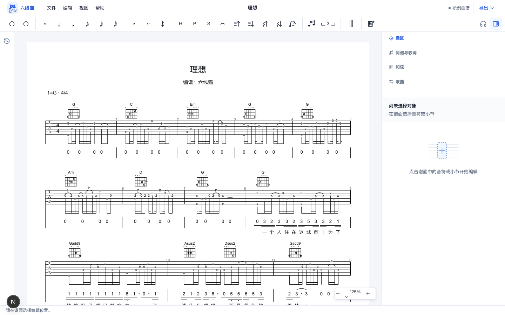

# 六线猫（liuxianmao）

**把想弹的，写成谱。**

六线猫是一款在浏览器里使用的吉他曲谱编辑器。想记下一段指弹、整理一首弹唱谱，可以把六线谱（TAB）、简谱、歌词和和弦指法写在同一份谱里。



## 从这里开始

- **写一份吉他谱。** 启动本地站点，打开 `/editor` 试着修改示例曲《理想》，也可以新建空白谱或导入已有的六线猫专用谱（`.lxm`）。[本地开发](#本地开发)
- **在 React 应用里嵌入编辑器。** 在 React 19 应用中使用 `@liuxianmao/lxm-editor-react`，通过 `createEditorSession` 创建会话，再挂载自带谱面、工具栏和侧栏的 `LxmEditor`。[React 接入指南](packages/lxm-editor-react/README.md) · [网站接入示例](apps/website/app/editor/EditorWorkspace.tsx)
- **自己做编辑器或处理曲谱数据。** `@liuxianmao/lxm-editor` 是 JavaScript Core，提供曲谱加载与校验、编辑命令、撤销重做、谱面布局与点击命中、绘制图元和播放计划。开发者可以用这些接口实现自己的界面与播放逻辑，也可以在 Node.js 中处理曲谱。[Core 使用指南与示例](packages/lxm-editor/README.md) · [v1.0 公共 API](packages/lxm-editor/docs/api-v1.md)
- **用 Agent Skill 接入。** 安装 `lxm-editor` 后，可在自己的项目中查询 Core 和 React 公共 API，运行 Node.js 或 React 19 示例。[安装和调用](skills/README.md)

## 写谱、试听与导出

- **在谱面上编辑。** 选中音符或小节，调整时值、节奏型和演奏技巧，补上简谱、歌词和和弦，也可以用和弦库查找指法或自定义指法图。[编辑工作台](docs/v1/design-baseline/editor.md) · [和弦与指法](docs/v1/design-baseline/chords.md)
- **听一遍，再跟拍练习。** 六线谱支持木吉他试听，可从谱首或选中的小节开始播放。节拍器可独立计拍，也可在试听时跟随曲谱。[曲谱试听](docs/v1/design-baseline/score-files.md) · [节拍器](docs/v1/features/REQ-095-guitar-metronome/README.md)
- **保存可编辑的谱，或分享成品。** 导出 `.lxm` 留待下次编辑，导出 PNG 发给琴友，或使用 A4 预览打印并通过浏览器另存 PDF。[曲谱文件与输出](docs/v1/design-baseline/score-files.md#a4-图片和打印)

## 本地开发

在仓库根目录安装依赖并启动开发任务。仓库使用 `pnpm@9.15.9`。

```bash
pnpm install
pnpm dev
```

启动后访问 `http://localhost:3000` 查看首页，或访问 `http://localhost:3000/editor` 进入编辑器。端口以终端输出为准。

在仓库根目录还可运行以下检查和构建命令。

```bash
pnpm build
pnpm lint
pnpm test
pnpm type-check
```

## 项目文档与设计资料

- 项目文档汇总功能、架构与部署资料。新增 v1.0 需求、交互稿和交付方案时，在工作区建立交付条目。[六线猫项目文档](docs/README.md) · [v1.0 工作区](docs/v1/README.md)
- 设计基线记录当前交互与验收依据。MVP 归档保留历史版本、评审稿与交付记录。[v1.0 设计基线](docs/v1/design-baseline/README.md) · [MVP 归档](docs/archive/mvp/README.md) · [MVP 设计 v2 归档](docs/archive/mvp/design-v2/README.md)

## 编辑器源码导航

- React 工作区包含会话协调、编辑表单、谱面、试听和浏览器输出。[React 编辑器源码导航](packages/lxm-editor-react/src/EditorShell/README.md)
- Core 的领域模块处理文档校验、命令、节奏、简谱、歌词、和弦与技巧。布局模块负责排版和几何计算，命中与选区共用最终坐标。[Core 领域模块](packages/lxm-editor/src/core/README.md) · [Core 布局模块](packages/lxm-editor/src/layout/README.md)
- 目录整理记录保留迁移约束与验证结果，图标归档收录工具栏原始 SVG 素材。[编辑器目录整理记录](docs/archive/mvp/versions/v8/20261111_编辑器目录分组与模块内聚整理.md) · [MVP 图标素材归档](docs/archive/mvp/extracted-svg-icons/README.txt)
