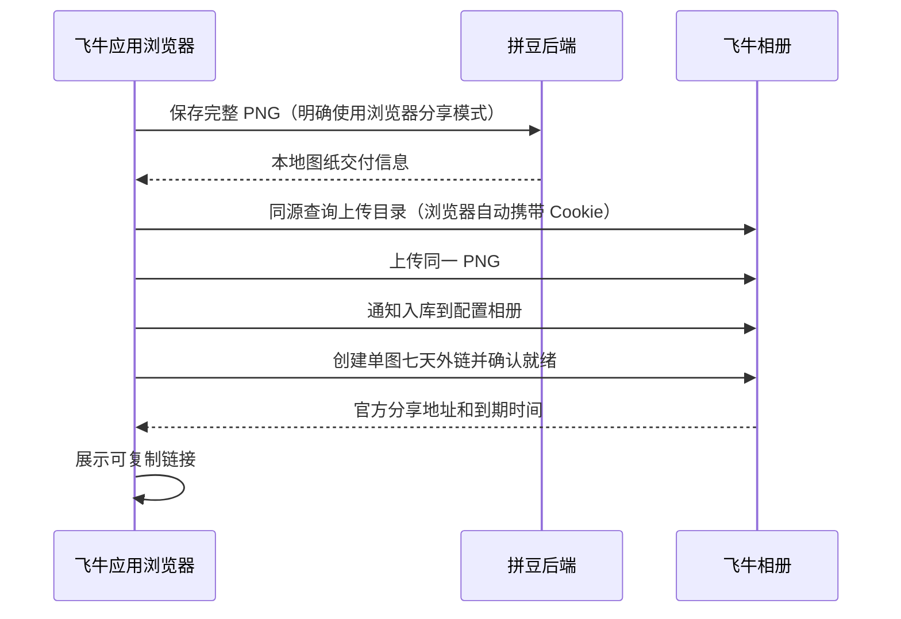

# 飞牛应用上传会话修复技术方案

状态：用户已确认，修复已实现并部署到 NAS，正式代码上传分享实测成功。

## 已确认原因

飞牛统一网关会过滤系统登录 Cookie。它校验会话后，转发 `X-Trim-Userid` 等用户身份头给第三方应用，并不将完整系统登录会话交给应用。

| 实机检查 | 结果 |
| --- | --- |
| 当前浏览器访问拼豆 | 已登录，可正常打开 |
| 浏览器会话密钥 | 存在，Base64 格式有效 |
| 拼豆后端收到会话密钥 | 是 |
| 拼豆后端收到 `ost` / `fnos-token` | 均未收到 |
| 浏览器直接同源访问带有效签名的相册上传目录接口 | HTTP 200，业务 code 0，有上传权限 |
| 当前拼豆上传接口 | HTTP 401，`NAS_ALBUM_SESSION_INVALID` |

临时诊断仅返回字段存在性和名称，不输出 Cookie、密钥或身份值；诊断代码已从 NAS 移除。

官方文档：[统一网关](https://developer.fnnas.com/docs/core-concepts/gateway-registration/)。该文档说明网关先验证登录并转发用户身份 Header；Cookie 过滤结论来自本次实机观测。

## 修复方式

由浏览器调用同源飞牛相册接口。浏览器自动携带系统 Cookie，JS 无需读取 HttpOnly `ost`；服务端只保存完整图纸。保留现有后端适配能力用于显式单地址或兼容环境，但飞牛页面不再依赖网关转发系统 Cookie。

| 位置 | 实现要求 |
| --- | --- |
| 后端交付接口 | 增加明确的浏览器分享模式，仍校验管理员权限、先保存 PNG；返回服务端配置的相册 ID，不接受前端随意覆盖上游地址 |
| 前端相册适配模块 | 复用已验证的五个接口及签名协议；请求只能发往 `window.location.origin` 的固定路径，禁止外部 API 接收系统会话材料 |
| 前端上传入口 | 保存与相册上传使用同一 Blob；仅在外链就绪后展示成功；移除向拼豆 API 发送会话密钥和 token 的行为 |
| 签名兼容 | MD5 与 HMAC-SHA256 与现有固定向量一致；支持内网 HTTP IP 环境，不仅依赖 HTTPS 才有的 Web Crypto API |
| 时间和重试 | 同一流程有总时限；取消、页面结果失效时丢弃旧结果；上传开始后不自动重放，分享就绪查询有次数上限 |
| 错误提示 | 区分缺少会话密钥、实际登录失效、权限不足、上传/入库/分享异常；保留已保存的本地图纸 |

这样通过内网 IP 打开应用时，相册请求走同一 IP；通过 `https://nice007.fnos.net` 打开时走该网关，不需要把登录 Cookie 从应用后端转发出去，也不需要共享管理员登录。

## 验证与部署

1. 为实际失败链路补回归：网关不转发 `ost` 时，浏览器模式仍能保存并继续同源相册流程。
2. 用现有签名固定向量校验浏览器实现；覆盖入库去重、分享异步就绪、会话失效、外部 API 拒绝、取消与旧异步结果失效。
3. 运行相关前后端测试、类型检查和生产构建。
4. NAS 上先备份并构建独立标签，仅切换飞牛 API/Web；失败自动恢复。
5. 使用当前登录浏览器上传一张小型测试 PNG，确认返回七天外链并可预览。本次不调用 AI 转换或图片生成服务。

手机飞牛宿主若不提供 `fnos-Secret`，需要通过原生桥单独适配。后续提交 `9be43fd` 已补充 `getUserMessage` 接入，并部署飞牛 Web 镜像 `mobile-session-9be43fd-20261102`；服务健康、登录入口及实际静态脚本检查通过，手机会话 payload 及上传仍待实机验收。详情见 [App 会话适配部署记录](devops/20261102_飞牛App会话适配部署记录.md)。本文下面记录的完整相册上传实测仍为网页端结果。

## 实现与验收结果

| 项目 | 结果 |
| --- | --- |
| 浏览器分享接口 | `share_mode=browser` 不依赖后端收到 `ost`，仍执行原管理员鉴权和 PNG 校验 |
| 会话处理 | 会话密钥只在浏览器生成签名，不发送给拼豆后端；NAS 请求固定当前来源 |
| 错误提示 | 区分 401 登录失效、403 相册权限不足和宿主未提供密钥 |
| 异步结果 | 重试、更换图纸及离开页面时取消上传，忽略旧响应和旧导出结果 |
| 自动化验证 | 后端 260 项通过、1 项环境相关跳过；前端相关回归、TypeScript、ESLint、生产编译通过 |
| 代码审查 | 未发现有依据的协议、跨域、取消或契约问题 |

实机进一步发现原目标相册 `25` 不在验证用户可见列表中，入库返回 403。用户随后手动创建“拼豆”相册，读取到 ID 为 `31`；经用户确认，运行配置已更新为该相册，未重复创建相册。

NAS 镜像更新为 `pindou-fnos-api:sessionfix-20261102` 与 `pindou-fnos-web:sessionfix-20261102`。配置及数据库备份位于 `/vol2/pindou-deployments/sessionfix-20261102/backup`，可使用同目录 `rollback.py` 恢复切换前的 API/Web 镜像和配置，不覆盖业务数据库。

通过 NAS 正式页面加载的生产代码，以同一份 32×32 PNG 完成后端保存、浏览器上传相册 `31`、创建七天外链：

- 外链：`https://share.fnnas.net/s/6f4785a4004f44638e`。
- 到期：`2026-11-09T11:37:43Z`。
- 分享页显示一张图片，实际缩略图加载成功。
- 飞牛 API/Web 健康，Socket 页面/资源/API 检查通过；proxy、PostgreSQL 及其他业务容器没有重建。
- 临时诊断路由已移除，专用构建器已停止，浏览器验证会话已关闭。本次未调用 AI 转换或图片生成服务。

本次同时解决了前次审查记录中的跨域 API 会话泄露风险，以及切换图纸时旧异步导出/上传结果覆盖问题。
