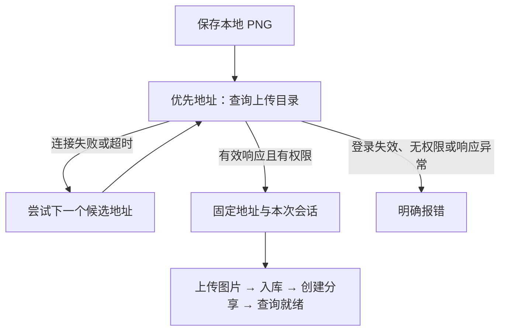

# 飞牛相册多地址访问技术方案

状态：已实施；支持可信候选集合内的当前访问来源优先，以及上传前网络失败回退。

## 当前行为与问题

相册 HTTP 请求由 API 后端发起，浏览器只调用拼豆自己的 API。当前 `NAS_ALBUM_BASE_URL` 已支持环境变量覆盖，但只能配置一个地址；默认 `http://host.docker.internal:5666`。没有内网优先或网关回退。

| 路径 | 决定地址的网络环境 |
| --- | --- |
| 浏览器 → 拼豆应用 | 浏览器所在网络，可以是内网 IP 或外网网关 |
| 拼豆后端 → 飞牛相册 | 后端所在网络，与浏览器是否在内网无必然关系 |
| 用户 → 图片分享链接 | 使用飞牛返回的官方 `share_url` |

如果 API 始终运行在 NAS 内，外网用户访问应用时，后端通常仍可走宿主直连。只有后端无法直连时，才需要改走网关。

## 推荐实现

### 服务端配置候选地址

新增 `NAS_ALBUM_BASE_URLS`，值为按优先级排列的 JSON 字符串数组：内网 IP 或宿主地址在前，HTTPS 网关在后。配置只能包含指向同一台 NAS 的可信地址。

```dotenv
# 示例地址需要替换为实际部署值。
NAS_ALBUM_BASE_URLS='["http://192.168.1.10:5666","https://nas.example.com"]'
```

| 配置 | 行为 |
| --- | --- |
| 配置了非空 `NAS_ALBUM_BASE_URLS` | 按列表顺序尝试 |
| 未配置新变量 | 兼容原有 `NAS_ALBUM_BASE_URL` 和宿主默认值 |
| 新变量为空列表或包含非法地址 | 启动时明确报错，不悄悄退回默认地址 |

浏览器同源上传 POST 的 `Origin` 可以调整候选优先级：协议、主机和有效端口与某个已配置来源精确匹配时，将其放在首位。例如，配置了 `https://nice007.fnos.net`，通过该网关访问时优先使用该地址。未匹配时仍按列表顺序。默认端口和主机名大小写规范化处理。

不直接根据浏览器的 Host、Origin 或请求参数创建新上游。这样 Cookie 和上传签名密钥只会发往服务端配置的可信地址。

### 上传前选择，上载期间固定



- 使用已有只读的上传目录查询选择地址，不增加写入式探测。
- 仅在开始上传前，因连接失败或超时尝试下一地址；共享当前流程的总时限，避免每个候选地址重新获得 90 秒。
- 上传开始后不自动切换地址、不重放上传或创建分享，避免超时后产生重复图片和分享记录。
- 401、403、重定向、证书校验失败及业务错误明确返回，不自动回退绕过错误。
- 候选列表限制数量并去重；每个地址沿用现有校验：只允许 HTTP(S)，禁止用户信息、路径、查询和片段。
- 保持每次请求独立会话、关闭环境代理和重定向、启用 HTTPS 证书校验。

## 修改范围与验收

| 位置 | 变更和验收 |
| --- | --- |
| API 配置 | 解析和验证候选列表；验证原单地址配置兼容 |
| 相册适配器及交付路由 | 在上传目录查询阶段选择上游，后续全流程固定地址 |
| 适配器测试 | 来源白名单精确匹配、内网优先、连接失败回退、全部不可达、鉴权失败不回退、证书失败不回退、写入后不重放、总时限 |
| 环境变量示例、飞牛部署文档 | 添加双地址配置示例及网关路径兼容要求 |

不需要修改页面。实际网关是否直接提供 `/p/api/...` 和 `/upload`、是否接受同一 NAS 会话，需要在配置实际地址后单独验证；如果网关要求额外路径或认证，应依据实机行为补充适配，不能视为普通地址替换已经可用。

## 已确认决策

用户选择「服务端内网优先、不可达时回退到配置网关」，并要求当前访问 IP 或网关域名参与判断。实现采用可信候选集合内的来源优先策略，保留上传前网络失败回退和旧配置兼容。

## 实现与验证结果

- 新增 `NAS_ALBUM_BASE_URLS`；未配置或为 JSON `null` 时沿用旧单地址配置。空数组和超过四个地址在启动时拒绝；按 HTTPX 的域名规则规范化、去重，避免国际化域名变成其他主机。
- 同源 POST 的 `Origin` 仅用于精确匹配已配置地址并调整优先级；上传目录查询阶段可回退，后续写入流程固定地址。
- API 全量测试：248 项通过，1 项 PostgreSQL 环境相关测试跳过；相册相关测试 82 项覆盖地址排序、回退、国际化域名和原上传分享流程。
- 本次修改的 Python 文件通过 Ruff 检查，`git diff --check` 通过；需求及规范审查发现的国际化域名问题已增加回归测试并修复。
- 没有执行真实 NAS 上传或部署。实际内网 IP、网关地址需写入部署 `api.env`，网关 Cookie 接受情况与手机宿主会话仍待实机验收。
- 同时将本地 `secrets.env` 排除在 Docker 构建上下文之外。

原检查另发现两个前端问题（跨域 API 配置下的会话头发送、切换图纸时旧异步结果覆盖），已加入项目待办，未纳入本次 NAS 上游地址改动。
