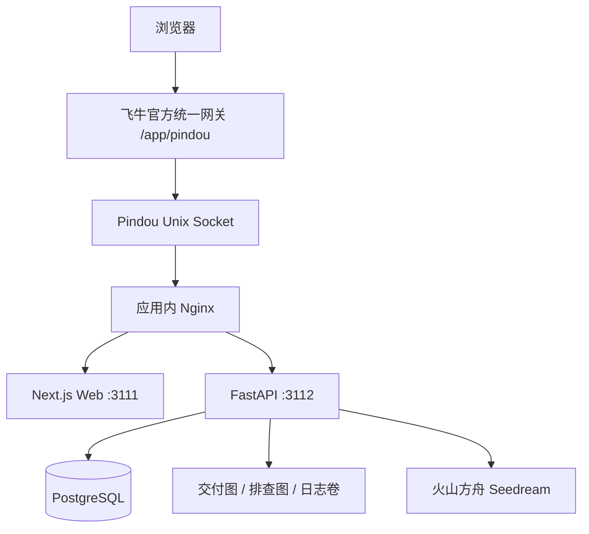

# Pindou 飞牛 NAS 官方统一网关 Docker 实施方案

## 1. 已确定的方案

NAS 应用采用 Docker 运行，外部入口固定为飞牛官方统一网关 `/app/pindou`。用户已接受该前缀，不再验证或尝试注册 `/pindou` 短路径。

```text
https://<NAS访问域名>/app/pindou/
https://<NAS访问域名>/app/pindou/colors/
https://<NAS访问域名>/app/pindou/gk/fnos/
https://<NAS访问域名>/app/pindou/delivery/<token>/
```

应用复用 NAS 域名、HTTPS 和登录会话，不配置独立域名、自定义系统反向代理或宿主机端口。完整构建/打包命令、真实镜像发布要求和设备验收见 [飞牛应用包说明](../../deploy/fnos/README.md)。普通 Web 部署保留现有独立配置，两者共享业务代码。

## 2. 运行架构



服务为 `proxy`、`web`、`api`、`postgres`，均无宿主机端口映射。飞牛通过 `${TRIM_APPDEST}/pindou.sock` 将请求交给 proxy，proxy 保留 Web 前缀、剥离 API 前缀。容器间通过 Compose 网络通信。

当前 API 生产环境要求 Seedream，安装需要方舟密钥和网络出口，NAS 部署不等于离线 AI。

## 3. 路径、构建与前端改造

以下路径相对 `apps/pindou/`：

| 外部路径 | 容器路径 | 行为 |
| --- | --- | --- |
| `/app/pindou` | `/app/pindou/` | 保留查询参数的尾斜杠跳转 |
| `/app/pindou/`、`colors/`、`gk/*/`、`delivery/*/` | Web 同路径 | 保留完整前缀 |
| `/app/pindou/_next/*` | Web 同路径 | 包括动态模块和 CSS |
| `/app/pindou/api/v1/*` | API `/api/v1/*` | 仅剥离 `/app/pindou` |
| `/app/pindou/readyz` | API `/readyz` | Socket 健康检查，无业务数据 |

Web 构建参数固定为 `NEXT_PUBLIC_BASE_PATH=/app/pindou`、空 `NEXT_PUBLIC_API_BASE_URL`，使用 Next `standalone` 产物。前缀在构建阶段固化；NAS 安装时拉取预构建镜像，不现场编译或运行时更改前缀。

`apps/web/src/lib/paths.ts` 统一 API 请求、返回文件地址和分享链接，消除原先固定公网 API 与分享链接丢前缀的问题。NAS 浏览器请求使用同源路径，后端保持内部 `/api/v1` 及空 `root_path`。API 返回图片/下载地址仍是 `/api/v1/...`，前端只增加一次挂载前缀。

proxy 将 API 尾斜杠规范化的 `Location` 改写为 `/app/pindou/api/v1/...` 相对地址，保留查询参数及浏览器的外部 HTTPS 协议；不在容器内推断 NAS 外部域名。

Next `Link` 自动处理 `basePath`；原生链接和分享使用路径工具。公开 API 地址配置仅供普通部署显式使用，NAS 镜像传空值。NAS 会话失效返回登录 HTML 时，前端显示重新登录提示。保留 `Referrer-Policy: no-referrer`，含密钥页面设置私有、禁止存储缓存。

## 4. 飞牛包与生命周期

包目录为 `deploy/fnos/`，包含 `manifest`、图标、`app/ui/config`、`config/resource`、`config/privilege`、向导和 `cmd/` 生命周期脚本；Docker Compose 位于 `app/docker/docker-compose.yaml`。

- 应用名为 `pindou`，网关前缀 `/app/pindou`，Socket 文件名 `pindou.sock`；不声明应用 TCP 服务端口。
- Docker 项目名固定为 `pindou-fnos`，避免与现有普通部署的 `pindou` 项目冲突。项目交给 fnOS `docker-project` 管理，`cmd/main start/stop` 不重复控制 Compose；status 只检查本项目的四个容器及健康状态。
- 首次安装由一次性 helper 创建配置、随机数据库密码、管理密钥和哈希 pepper；重复初始化保留稳定密钥。已有数据但缺配置时拒绝重新生成密钥，要求从备份恢复。
- API 启动先执行 Alembic 迁移，随后幂等初始化 `fnos` 来源前缀；不重新启用已被管理员停用的前缀。数据库连接 URL 正确编码，Alembic 处理 `%` 转义。
- 配置向导更新方舟密钥，留空保留旧值；按说明停止再启动使配置生效。高级模型参数由管理员维护受限配置。
- 生命周期脚本需要 Docker 访问及目录属主设置，采用官方 root 生命周期权限；常驻 API/Web 按各自非 root 用户运行，不向业务容器挂载 Docker Socket。
- 首版目标架构为 x86/amd64，最低 fnOS 版本及 Socket 权限以目标设备验收为准，不宣称尚未验证的平台兼容性。
- 包图标复用 `apps/web/src/assets` 中的 64/256 像素原图。容器限制 CPU 和内存，具体上限见包说明；真机调试使用独立构建器、镜像标签与数据目录。

## 5. 配置与数据

| 位置 | 内容 |
| --- | --- |
| `${TRIM_PKGETC}/api.env` | 数据库 URL、业务管理密钥、pepper、方舟配置 |
| `${TRIM_PKGETC}/postgres.env` | 数据库名、用户、密码 |
| `${TRIM_PKGVAR}/postgres` | PostgreSQL 数据 |
| `${TRIM_PKGVAR}/image-deliveries` | 短期交付 PNG |
| `${TRIM_PKGVAR}/api-images`、`api-logs` | 排查图片、应用日志 |
| `${TRIM_APPDEST}/pindou.sock` | 可重建 Socket，非业务数据 |

配置文件权限为 0600，日志不输出密钥；初始化不依赖 NAS 安装 Python，使用 API 镜像内的 helper。源文件中是不可拉取的占位镜像，构建/打包脚本要求实际镜像引用，发布前必须推送镜像或预加载到测试 NAS。

升级前备份配置、数据库和文件。pepper 必须随数据库恢复，否则旧消费密钥失效；交付 TTL 基于文件 mtime，备份恢复须保留时间信息。迁移失败不启动 API；数据库迁移不保证可逆，回滚可能需要恢复备份。

卸载脚本不主动删除业务数据，但不能保证 fnOS 自身卸载清理后目录保留；向导明确要求先备份。首版不提供未经真机验证的数据删除或自动保留承诺。日志及排查图片保留策略由管理员维护，自动容量治理另行扩展。

## 6. 网关与业务边界

飞牛负责 NAS 登录校验，Pindou 保留 `X-API-Key` 和 `X-Admin-API-Key` 业务授权；`allUsers=true` 只影响入口可见性，不授予管理员权限。首版不自动把 `X-Trim-*` 变成业务权限，也不新增 NAS 多用户数据归属模型。

分享链接仍经过官方网关，接收者需要 NAS 登录及相应应用访问权限；交付 token 无法绕过系统登录。仅官方网关入口不支持本方案下的匿名公网分享。

应用代理设置请求体与超时限制、禁止转换 POST 自动重试；这些设置不能提升官方网关本身的限制。发布前实测 30 MiB 交付上传、长转换和登录失效行为，若上层限制更严则调整应用上限；若需要异步任务则另做持久化任务设计。

## 7. 验证与交付标准

代码与本地验证包括路径单元测试、现有业务测试、Web lint/类型检查、`/app/pindou` 生产构建、生产页面资源路径检查、包内 Shell/Python/JSON/Compose 校验及官方 fnpack 打包。实际执行结果以开发交付说明为准，不把打包成功当作容器或 NAS 已部署成功。

目标设备需完成：

1. 发布镜像可拉取且架构匹配，安装初始化成功，四容器健康，Socket 可由官方网关访问。
2. 登录后打开首页、色卡、签发及交付深层链接，刷新不丢前缀；静态资源、图片、API、下载走同源。
3. 未登录/会话过期由系统拦截并能恢复访问；业务密钥鉴权和额度保持原逻辑。
4. 使用测试额度验证转换、上传及下载，检查网关大小/超时限制和日志脱敏。
5. 应用及 NAS 重启、配置更新、升级和备份恢复后旧密钥、额度及未过期图片可用；核对卸载时的系统数据清理行为。

## 8. 参考

- [飞牛统一网关](https://developer.fnnas.com/docs/core-concepts/gateway-registration/)
- [飞牛 Docker 应用案例](https://developer.fnnas.com/docs/examples/docker/)
- [飞牛应用框架](https://developer.fnnas.com/docs/core-concepts/framework/)
- [飞牛权限](https://developer.fnnas.com/docs/core-concepts/privilege/)
- [Next.js basePath](https://nextjs.org/docs/app/api-reference/config/next-config-js/basePath)
