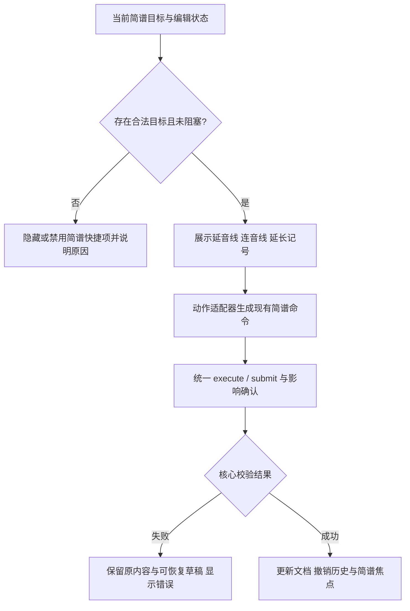

# 简谱音符技巧与范围复用交互优化方案

日期：2026-10-19  
状态：已复核并按方案实施（2026-10-19）  
范围：依据简谱音符技巧与范围复用设计稿，仅规划编辑器交互及界面调整，不在本文档阶段实施代码。

## 1. 背景与目标

当前“段落 → 简谱”面板已用折叠区承载「音符技巧」和「范围复用」。折叠态能节省空间，但用户难以发现展开后可做的具体操作。与此同时，工具栏现有「技巧」入口主要承载六线谱演奏技巧选择，没有为简谱音符提供直接的延音线、连音线和延长记号入口。

本方案让高频简谱记号操作在选中简谱音符后可从工具栏直接触达，并补齐音符技巧与范围复用的完整展开态。现有领域命令、简谱草稿、影响确认、撤销历史和范围剪贴板继续作为唯一业务实现来源。

目标：

1. 提高延音线、连音线、延长记号的发现性和操作效率。
2. 使「音符技巧」展开区能完成音高编辑、时值调整、连接端点配置和已有记号管理。
3. 使「范围复用」展开区明确当前作用范围，并可完成复制、覆盖、插入、合并及移除连音组。
4. 所有操作复用当前命令与校验链路，不增加新的曲谱数据格式或 API。

## 2. 依据与现状

设计依据：

- [10_独立简谱_音高时值与技巧属性](../01_设计稿/20261013_UI交互设计稿/04_歌词简谱与和弦/10_独立简谱_音高时值与技巧属性.png)
- [16_简谱_范围复用展开操作](../01_设计稿/20261013_UI交互设计稿/04_歌词简谱与和弦/16_简谱_范围复用展开操作.png)
- [段落简谱表单紧凑布局说明](../01_设计稿/20261013_UI交互设计稿/20261019_段落简谱表单紧凑布局说明.md)
- localhost:3000 当前「技巧」菜单，以及「段落 → 简谱」中的技巧/范围复用实际展开态。

现有代码基础：

- `NumberedEditor.tsx` 已提供当前音符时值应用、等分持续音、起始音符/单音符音高编辑、升降还原与八度调整、延音线/连音线端点、延长记号切换、已有记号更新/删除。
- 同一编辑器已提供简谱范围复制、覆盖、插入、合并至终点及连音组移除。
- `packages/lxm-editor/src/core/numbered-commands.ts` 已有 `numbered.mark.add/remove/update`、`numbered.range.paste`、`numbered.event.merge`、`numbered.tuplet.remove` 等命令；`numbered-clipboard.ts` 提供独立简谱剪贴板与边界校验。
- `EditorToolbar.tsx` 通过 `TechniqueToolbar` 展示既有六线谱技巧工具，并统一接收 `blocked`、命令执行器及编辑器状态。工具栏不能直接绕过属性草稿/影响确认门控。

当前缺口主要是入口组织和可视层级：高频简谱技巧没有独立快捷入口；「范围复用」展开态缺少醒目的作用范围提示；静态稿没有把两种展开态分别表达清楚。

## 3. 交互方案

### 3.1 简谱技巧工具栏快捷项

当编辑器处于简谱编辑上下文并选中可操作的简谱事件/音符时，在顶端工具栏展示三个快捷项：

- 添加延音线
- 添加连音线
- 切换延长记号

快捷项只负责快速触发动作，不承载目标选择或复杂参数编辑。延音线/连音线依赖已有的「起始音符」「连接终点」选择；如果当前没有合法终点，则按钮禁用并提供原因提示。延长记号以当前事件为目标，显示当前启用状态，并沿用已有记号的切换规则。

若当前活动对象是 TAB 选区、没有简谱目标，或编辑器正处于未提交简谱草稿/待确认影响阻塞状态，则简谱快捷项隐藏或禁用，避免把操作施加到错误对象或绕过现有保护。具体显隐策略统一由编辑器工具可用性状态导出，不在按钮组件内重新推导领域规则。

工具栏保留现有「技巧」菜单，继续服务六线谱技巧，不改其现有选项、参数流程或命令行为。

### 3.2 音符技巧展开区

展开后按音符操作顺序分组：

1. **时值**：显示当前时值摘要；「应用当前音符时值」与「等分持续音」并列。仍分别触发原有命令。
2. **音高**：起始音符选择与单音符音高输入并列；升音、降音、还原、低一八度、高一八度同组；「应用单音符音高」紧随输入控件。
3. **连接与记号**：选择连接终点；同组呈现添加延音线、添加连音线和切换延长记号。无合法终点时禁用依赖终点的连接按钮。
4. **已有记号**：存在可编辑记号时显示其类型及更新端点/删除操作；无记号时不占用常驻区域。

单音符音高、时值、连接记号和内容主表单继续分别提交。展开/折叠本身不提交、不取消，也不重置草稿。

### 3.3 范围复用展开区

范围复用展开后先显示只读作用范围摘要（例如“第 2 拍 – 第 4 拍 · 共 3 个音符”），明确所在简谱行/小节及起止 tick 对应的可读位置。下方操作分为：

- **复制**：复制当前简谱草稿窗口范围，成功后展示已复制状态；若剪贴板报告边界连接未复制，继续显示既有遗漏说明。
- **粘贴**：覆盖简谱、插入简谱并列展示。无剪贴板内容时禁用并说明先复制；覆盖受当前覆盖确认选项控制。
- **选区操作**：存在当前事件/合法终点时展示“合并至终点”；处于连音组内时展示“移除简谱连音组”。不适用的操作隐藏或禁用并显示明确原因。

复制只更新现有简谱剪贴板状态，不修改曲谱。覆盖、插入、合并和移除分别经现有命令提交；核心规则负责拒绝切断事件/连音组、非连续合并、越界粘贴或未经确认的覆盖。

## 4. 模块职责与接口边界

| 模块 | 职责 | 不承担 |
| --- | --- | --- |
| `EditorToolbar` | 根据当前编辑上下文、稳定简谱目标和统一工具可用性状态显示快捷项；转发用户动作 | 推导连音/延音合法性、直接改写曲谱对象 |
| 简谱技巧快捷动作适配器（实现阶段确定是否内聚在工具栏） | 把当前稳定简谱目标转换为既有 `ILXMScoreCommand`；统一检查阻塞状态并调用 `execute` | 自建领域规则、独立维护第二份简谱数据 |
| `NumberedEditor` | 承载技巧与范围复用表单；维护局部草稿和展开态；调用既有 `submit` / `copyRange` / `getClipboard` | 修改命令语义或复制核心校验 |
| `numbered-commands.ts` 与 clipboard 模块 | 作为简谱命令、范围合法性、剪贴板验证和提交结果的权威实现 | 处理 React 展示或弹层状态 |
| Editor session/store | 提供当前编号音符目标、选区、剪贴板和编辑阻塞状态 | 将展开态写入曲谱文档或撤销历史 |

简谱工具栏动作的外部接口保持小而稳定：

```ts
type NumberedQuickTechnique = "tie" | "slur" | "fermata";

interface NumberedTechniqueActions {
  availability: Record<NumberedQuickTechnique, ToolAvailability>;
  run: (action: NumberedQuickTechnique) => void;
}
```

接口适配器负责把 action 解析为现有目标与命令；端点选择未完成时，不执行猜测性操作，而是将焦点转到「音符技巧」展开区并定位连接终点字段。该适配方式在评审后决定是否以回调形式传入现有 `EditorToolbar`，或由更上层 editor shell 装配，避免让通用 `TechniqueToolbar` 直接依赖简谱表单内部状态。

## 5. 状态与命令流程



简谱草稿目标切换、脏状态、pending 影响确认和命令 expected revision 继续沿用现有机制。工具栏快捷动作不得捕获过期选区；执行前从 session/store 获取稳定目标并校验 revision。失败时保留表单草稿，成功后由现有 store 对齐简谱焦点和文档版本。

范围复用操作依旧使用 `NumberedEditor` 中当前目标窗口和现有剪贴板：复制使用 `NumberedClipboardRange`；覆盖/插入使用 `numbered.range.paste` 并传当前 `allowOverwrite`；合并使用连续事件 ID 序列提交 `numbered.event.merge`；移除使用 `numbered.tuplet.remove`。摘要仅根据同一来源的目标与窗口派生，避免 UI 与命令范围不一致。

## 6. 实施步骤

1. 核验工具栏在简谱编辑上下文可以取得当前简谱目标、剪贴板、阻塞原因和可读小节/拍点位置；缺失信息通过最小化 props/store selector 传递。
2. 定义简谱快捷技巧 availability 纯函数：输入当前目标、文档、端点候选和阻塞状态，输出显隐/禁用状态与原因；最终合法性仍交给核心命令。
3. 在 `EditorToolbar` 装配简谱快捷项，避免修改既有 `TechniqueToolbar` 六线谱技巧菜单；动作统一进入现有命令 adapter 和影响确认流程。
4. 调整 `NumberedEditor` 展开态的分组、作用范围摘要及空/禁用状态；复用现有 field、submit、clipboard 与 command 逻辑。
5. 更新相关设计实施清单与文档，只记录本轮设计范围内的结果，不修改旧的历史测试或评审结论。

## 7. 验收标准

### 功能与状态

- 简谱选中目标时能看到三种快捷项；目标或编辑状态不合法时按 availability 隐藏/禁用并说明原因。
- 延音线要求合法同音端点，连音线要求合法连接目标；快捷项与面板按钮提交相同命令及影响确认。
- 延长记号对当前简谱事件切换，已有状态正确反映在工具栏和展开区。
- 时值、音高、连接/记号操作保持独立提交；展开/收起不改变 draft、预览、覆盖选项和 undo 历史。
- 范围摘要与实际复制/覆盖/插入范围一致；没有剪贴板、局部事件、越界、事件/连音组部分相交等状态均有明确反馈。
- 覆盖仍需用户显式允许；非法操作由核心命令拒绝且不产生文档变化；成功操作可撤销/重做。

### 视觉与可达性

- 常用简谱快捷项与现有节奏工具栏对齐，工具栏窄宽时按既有“更多工具”收纳规则处理，不挤压历史和节奏控件。
- 音符技巧和范围复用的标题、摘要、分组与设计稿一致；独立滚动时状态栏和页面布局稳定。
- 所有图标按钮有可访问名称、Tooltip/禁用原因和键盘焦点；展开态能使用键盘操作并正确关联 label。
- 1280、1024、768 与 650px 低高度场景无溢出、遮挡或主要入口不可达。

### 回归验证

- 简谱已有范围：复制成功、跨边界连接遗漏提示、覆盖未勾选拒绝、勾选覆盖成功、插入容量/部分相交拒绝。
- 连音组：合并普通连续事件成功；非连续/不同类型/连音组非法合并拒绝；移除连音组恢复成员时值。
- 技巧：有效/无效终点、延长记号新增与移除、pending 影响确认、草稿阻塞和过期 revision。
- 保持歌词、和弦和 TAB 技巧工具原行为；验证撤销/重做及导入导出 schema 不变。

## 8. 风险与控制

- **工具栏上下文冲突**：现有技巧菜单属于 TAB 技巧工具。采用独立的简谱快捷动作组，不把简谱模型耦合进通用 TAB 技巧适配器。
- **连接操作缺少目标参数**：工具栏不猜端点；没有目标时引导展开技巧区并聚焦终点选择，防止产生错误记号。
- **摘要与操作窗口分离**：摘要、按钮操作共用同一 `start/end/measure` 派生值；在调用命令时再由核心校验窗口。
- **未提交草稿与快速命令竞态**：使用现有 blocked 状态和统一命令 adapter；禁止绕过 dirty draft 与 pending impact guard。
- **超出设计范围的领域变化**：不修改命令 schema、模型、数据库、服务端 API、谱面布局算法或简谱记谱规则。

## 9. 变更范围

预计前端调整集中在 `EditorToolbar.tsx`、`NumberedEditor.tsx`、`index.module.scss` 及必要的工具状态/适配模块；测试优先落在对应现有 toolbar、numbered editor 和 numbered commands 测试文件。领域命令原则上零改动，只有发现设计要求无法由现有接口满足时才另行补充并更新方案。

## 10. 实施结果与验证

已按本方案完成第一版交互实现：

- `EditorToolbar.tsx` 新增简谱快捷操作组，仅在 editor store 存在简谱目标时显示。延长记号直接对当前事件新增/移除；延音线和连音线使用快捷 Popover 明确选择终点，再通过统一 `EditorCommandAdapter` 提交 `numbered.mark.add`。
- 延音候选限制为当前音符结束时刻紧邻、音高相同的后续简谱成员；连音候选限制为后续普通简谱事件。跨越小节边界、反复/终止线、重叠连接、连音交叉等完整领域规则仍由核心 `validateNumberedMarks` 裁决，不在 UI 重复实现。
- 技巧动作在提交时重新比对当前简谱目标，目标已切换则关闭/中止该动作。普通歌词、和弦和 TAB 编辑路径清除 store 中的简谱选择，避免快捷工具残留在错误上下文。
- `NumberedEditor.tsx` 范围复用区增加当前目标窗口摘要和剪贴板时长提示；无剪贴板时禁用覆盖/插入；覆盖确认未勾选时禁用覆盖。核心 `numbered.range.paste` 仍做最终容量、完整事件/连音组边界及 overwrite 校验。
- `index.module.scss` 增加范围摘要样式。没有新增数据模型、持久化字段或 API。

验证结果：

- `pnpm --filter @liuxianmao/website type-check` 通过。
- ESLint 对 `EditorToolbar.tsx`、`NumberedEditor.tsx`、`MusicTextSidebar.tsx` 通过，无 lint warning。
- `vitest run apps/website/tests/numbered-editor-draft.test.ts apps/website/tests/editor-session.test.ts packages/lxm-editor/tests/core/numbered-voice.test.ts`：26 项通过。
- `git diff --check` 通过。

本轮未修改 numbered core 命令；工具栏按“显式选择终点”实现，避免从当前音符静默推断目标。浏览器中已确认选中简谱音符后显示三种可用快捷项，并能打开延音线端点选择面板；本轮未点击最终应用，避免把验证操作写入当前本地谱面。窄屏视觉仍需后续手工验收；工作区此前已有其他未提交改动，本次未清理或回退。
