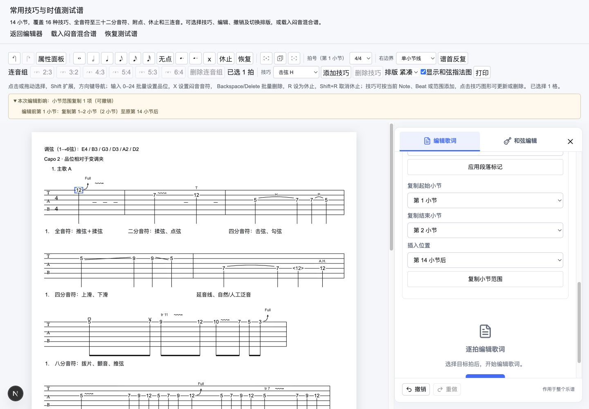

# MVP v7.1-B 单轨设置与多小节复用实施验收

2026-10-12。依据 [v7.1-B 技术方案](./20261010_v7.1-B单轨设置与多小节复用技术方案.md) 补齐此前只有模型和命令骨架的实现。本次交付限定为调弦/capo、小节段落标记、多小节插入复制；速度记谱仍按审查结论暂缓。

## 已实现

- 单轨标准/Drop D/自定义六弦调弦：音名可使用 A–G、升降号及八度，核心解析 MIDI；预设返回独立数据，schema/loader/命令使用同一校验函数。弦索引必须按 1–6 顺序、pitch/MIDI 必须一致。
- capo 整数 0–12。调弦和 capo 只改变设置，保留数字/x、和弦名称/图、节奏与技巧。谱首显示调弦、capo 和相对品位说明。
- `measure.setSectionLabel` 规范化单行段落文字，上限 32 个 Unicode 字符；空白/null 清除。核心生成标记几何，顶部独占行并避开技巧、和弦及正文；超长文字外框纳入画布宽度，保持原谱行宽度和断行规则。编号是标记所在小节的当前顺序号，复制/插入后自动更新。
- `measure.copyRange` 复制连续范围，侧栏可选择源起止与插入位置；谱首、源末小节之后及范围外锚点合法。工具栏支持跨小节选区，立即把涉及的完整小节复制到源范围之后，不覆盖已有音乐内容。
- 全源范围共享 Beat/Note 映射：复制完整包含的 16 类技巧、范围内跨小节连接/区间、歌词、和弦图、连音、拍号、小节线和段落标记；所有实体 ID 重建。触及范围但未完整包含的关系只报告一次遗漏，不建立外部引用。
- 插入打断旧 Tie 等关系时沿用清理和 `technique.removed` 说明；副本技巧与目标现有区间冲突时整次命令拒绝，避免成功结果悄悄丢掉新副本的技巧。
- `measures.copied` effect 带编辑前源起止编号、插入编号和小节数量；一次命令增加一次 revision、一次历史、一次宿主通知。失败不产生副本、历史或复制摘要。
- 设置以显式“应用”提交，设置草稿不进入历史。音乐文本草稿活跃时禁用设置/复制表单，已有歌词/和弦草稿保护不变。设置表单在切换目标小节、设置值发生历史变化或外部替换时重新初始化，未应用内容丢弃。

## 版本与宿主接口

正式文档为 schema 5；loader 拒绝 schema 4。`upgradeSchema4To5(input)` 是显式升级入口：接收 schema 4 对象，先校验旧字段形状，补 `capo: 0`，再执行正式 loader/schema/语义校验，返回 `DocumentLoadResult`。输入和音乐 ID 不变，错误不会覆盖宿主当前会话；loader 不自动调用升级函数。

```ts
const upgraded = upgradeSchema4To5(oldSchema4Object);
if (upgraded.ok) session.getState().replaceDocument(upgraded.document);
// upgraded.errors 由宿主展示；不要把 onChange 又回填成 replaceDocument。
```

旧 JSON 字符串需由宿主先解析成对象；不支持任意版本迁移。调弦不会自动转调和弦名称/指法，非标准调弦下已有和弦预设仍按现有界面规则禁用。

## 验证

- 全量 492 项：核心 443、网站 49。新增范围测试覆盖 2/4/8/14 小节、16 类技巧及跨小节关系、边界遗漏、旧 Tie 清理、目标冲突原子拒绝、闷音、连音/文本/边界、ID 唯一性及 loader；设置/升级/no-op/非法输入、长标记外框、单条历史、重复复制、撤销/重做、隔离和宿主单次通知。
- `pnpm test`、`pnpm type-check`、`pnpm lint`、`pnpm build`、`git diff --check` 通过。
- 桌面浏览器 1440×1000 `/technique-test`：Drop D 应用后谱首 E2→D2；capo 2、主歌 A 标记可见；侧栏复制 1–2 小节至第 14 小节后，选项增至 16，撤销恢复 14、重做恢复 16；非法调弦 bad 拒绝且谱首仍为 D2；重复复制后范围数量和标记编号正确；Shift+右方向键跨小节选区启用工具栏复制，摘要显示复制至原第 2 小节之后。浏览器 console error/warn 检查为空。
- 排版、编辑、打印共用同一 SVG 标记数据；本阶段没有声称系统打印/PDF、真实中文候选输入、100 小节性能或多浏览器最终验收通过，它们仍是 v7.2 的验收工作。



## 后续边界

v7.1-B 范围已完成。下一切片为 v7.1-C 拍点拆分/合并与 Beat 粘贴；之后为 v7.1-D 半音推弦，最后为 v7.2 分页输出与质量验收。作品管理、播放、多轨、保存文件 UI 均不属于本次交付。
