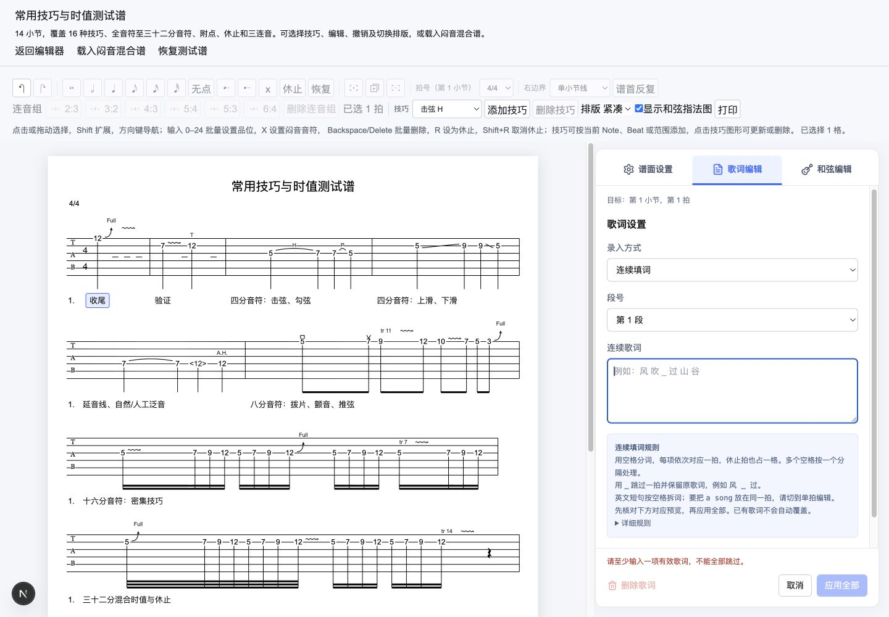

# MVP 7.1-B 收尾验收

> 日期：2026-10-12。状态：已完成。本记录补充此前单轨设置、多小节复用和常驻侧栏验收；当前文档为 schema 6。

## 最终交互

- 侧栏页签统一为“谱面设置 / 歌词编辑 / 和弦编辑”。已有选拍时，切到歌词或和弦页签直接载入该拍，不再要求额外点击“编辑当前拍”。
- 无选拍时先展示提示；随后点击 TAB 单元格立即进入当前文本页签的编辑。设置页在无草稿时保留普通选区和拖选流程。
- 换拍、切页签沿用同一草稿保护入口；继续编辑保留内容，应用后继续只在合法提交后切换目标，失败保留原草稿。
- 撤销/重做统一保留在顶部工具栏，移除侧栏重复入口；没有编辑操作和提示时隐藏侧栏底栏。
- 谱首标题、作者对齐和间距采用此前已提交的修订。设置、范围复制、宿主通知和 schema 不再增加新范围。

## 本次验证

- 全量 505 项测试通过（核心 452、网站 53）；`pnpm type-check`、`pnpm lint`、`pnpm build` 和 `git diff --check` 通过。
- `/technique-test` 浏览器验证：无选拍切歌词后点击第一拍直接进入连续填词；输入“收尾 验证”，切和弦触发保护，继续编辑保留输入；既有歌词覆盖未经允许时禁止应用。
- 允许覆盖后“应用后继续”写入两拍歌词，并进入原第一拍的和弦编辑；顶部撤销一次恢复原歌词并取消过期草稿，重做恢复两拍；再切歌词直接进入当前拍，默认连续填词。
- 1440×1000 桌面基线下侧栏、谱面和统一历史入口显示正常；返回设置页没有空底栏。浏览器捕获的 warn/error 为空。
- 设置页普通选区/拖选的代码路径保留；本次不将它或真实系统 IME、长谱、多浏览器、分页打印列为新增人工验收证据。后四项继续属于 v7.2。

## 阶段结论

7.1-B 与其验收修订收尾完成。按用户指令，原 7.1-C（拍点结构与 Beat 粘贴）和原 7.1-D（半音推弦）合并为 **7.1-C：拍点编辑、乐句复用与半音推弦**，下一阶段先审查合并技术方案。简谱展示旧草案不占用新的 C 编号，仍是独立待审查候选。
