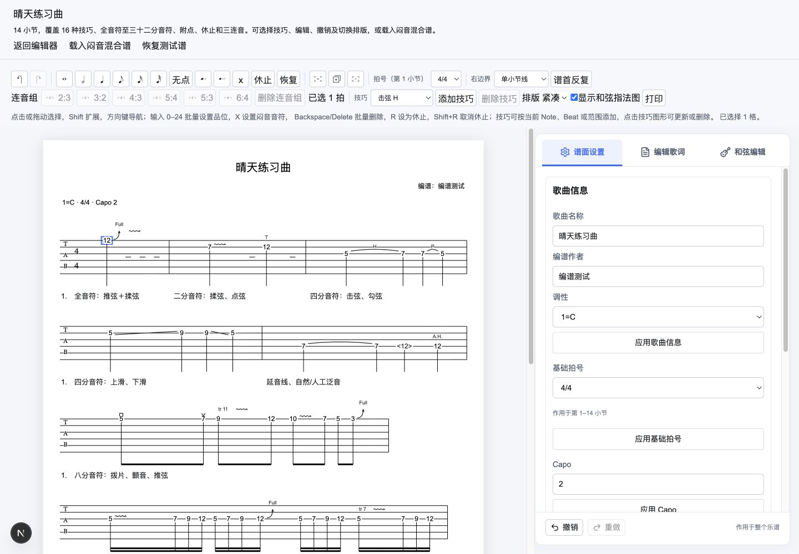
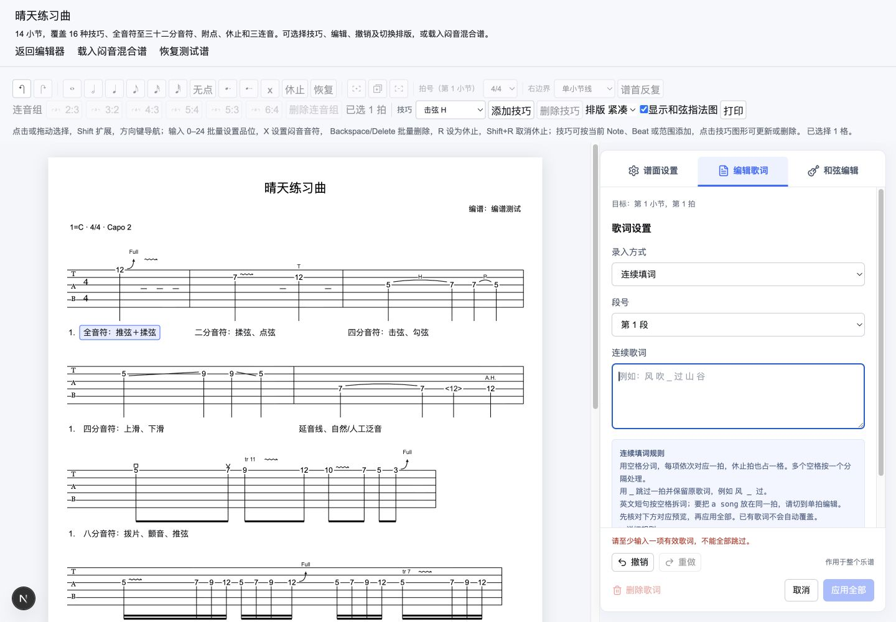
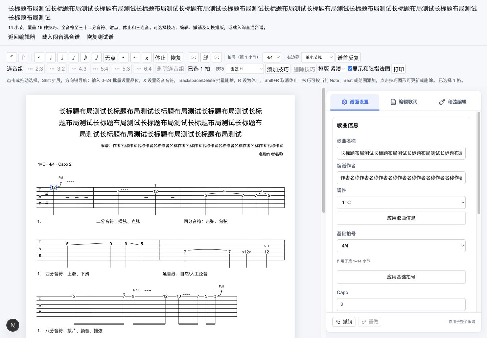

# 常驻侧栏与基础谱面信息实施验收

2026-10-12。依据 [调整方案](./20261012_常驻侧栏与基础谱面信息调整技术方案.md)，完成用户六项验收反馈。本记录取代旧 v7.1-B 记录中侧栏混排、调弦 UI、schema 5 和单拍默认的当前状态描述；旧记录作为历史证据保留。

## 1. 实际交付

- 侧栏随会话常驻；移除显隐按钮、关闭按钮、可见性状态和回调。Escape 只结束编辑或触发草稿处理，不隐藏侧栏。
- 三个独立页签：默认“谱面设置”、编辑歌词、和弦编辑。歌曲信息、基础拍号、Capo、段落标记和范围复制仅在设置页显示；歌词与和弦各自独立。公共历史操作保留。
- 删除 `TrackSettings` 的调弦界面，撤下谱首调弦文字；文档中的 tuning 及既有核心校验/命令保留，不修改加载的非标准调弦音乐内容。
- Capo 只显示位置，无相对品位说明；0 在谱首省略。
- `score.title`、`score.arranger`、`score.keySignature` 经 `score.setNotationInfo` 原子提交，规范化单行文字，名称 128、作者 64 个 Unicode 字符；调性为 12 个规范音名或 null，不触发转调。
- 谱首标题居中、编谱作者右对齐、调性/实际曲首拍号/非零 Capo 信息行展示。核心按单字形度量及保守净空折行，正文整体平移，渲染与打印共用同一布局；不依赖页面重新计算坐标。
- 基础拍号始终取第一小节。修改复用现有命令至下一已有变化点；局部小节拍号工具继续保留。无效缩容拒绝整次命令，不仅改变标记文字。
- 歌词默认连续填词；结束后重新进入仍默认连续。主动切到单拍后，同轮换拍、应用、删除保持单拍选择。连续模式仍保留分隔规则、`_` 跳过、预览与覆盖确认。

## 2. 草稿与历史契约

- 设置、歌词、和弦在切页签/换目标/结束编辑时共用应用、放弃、继续编辑保护。应用失败保留当前页签及草稿。
- 设置各表单独立应用，歌曲名称/作者/调性是一条命令和一条历史；应用歌曲信息不清掉尚未应用的 Capo 等其他字段。
- “应用后继续”先以纯命令规划验证全部待提交的设置表单，任何失败均不先保存前面的表单；成功后按各表单的独立命令顺序提交，分别进入历史和宿主通知。
- 自身提交使用既有提交标记，不误判为外部变更。撤销/重做及合法外部替换取消过期草稿；非法替换不覆盖会话。
- 页签支持方向键/Home/End，组合输入状态及候选 Enter 不作为提交/切换；真实系统候选操作的人工边界见第 4 节。

## 3. schema 与接入变更

正式文档升级到 schema 6，作者和调性是必需字段，空值分别为 `""` 和 `null`。所有内置示例同步升级，音乐内容/ID 保持不变。

```ts
const result = upgradeDocumentToCurrent(oldSchema4Or5Object);
if (result.ok) session.getState().replaceDocument(result.document);
// result.errors 由宿主展示，失败不覆盖当前会话。
```

- loader 只接受 schema 6；升级必须显式调用。旧作者默认空、调性默认未设置；schema 4 另补 capo=0，不推断调性或截断旧标题。
- 先校验旧字段形状，再校验当前结构与音乐语义；旧数据不符合新标题限制会明确拒绝。
- 历史 `upgradeSchema4To5` 已替换为 `upgradeDocumentToCurrent`；这是尚未发布的工作区包接口调整，调用方需更新导入和消费统一结果。历史文档中的旧调用示例仅描述当时版本。

## 4. 验证证据

- 全量 **505 项测试**：核心 452、网站 53。较上一切片新增 13 项，覆盖信息原子提交/不可变性/no-op、空值和非法值、schema 4/5 升级、长标题/作者布局与最终命中、歌曲信息历史通知、设置分组、默认连续、拍号段落边界及删除首小节后的读取。
- `pnpm test`、`pnpm type-check`、`pnpm lint`、`pnpm build`、`git diff --check` 通过。
- 桌面浏览器 1440×1000 `/technique-test`：设置“晴天练习曲 / 编谱测试 / 1=C”，同时保留未应用 Capo=2；切歌词触发保护，“应用后继续”后谱首显示 Capo 2，歌词页没有设置表单。
- 初次和重新进入歌词均默认连续；歌词草稿切设置触发保护。Escape 经处理后侧栏仍在；单拍应用和删除之后仍保持单拍模式。
- 4/4→3/4 的密集谱缩容给出“第 1 小节的真实内容超出新拍号容量，未修改任何小节”，谱首和正文仍为 4/4；合法空谱的基础拍号段落与变化点保留由会话测试验证。
- 长标题 84 字和作者 48 字真实折行，标题、作者、信息行、技巧及正文互不覆盖；浏览器 console error/warn 检查为空。
- 本次验证没有替代真实系统 IME 候选操作、系统打印/PDF、长谱性能和多浏览器的后续人工验收，不标记整个 MVP v7 完成。






