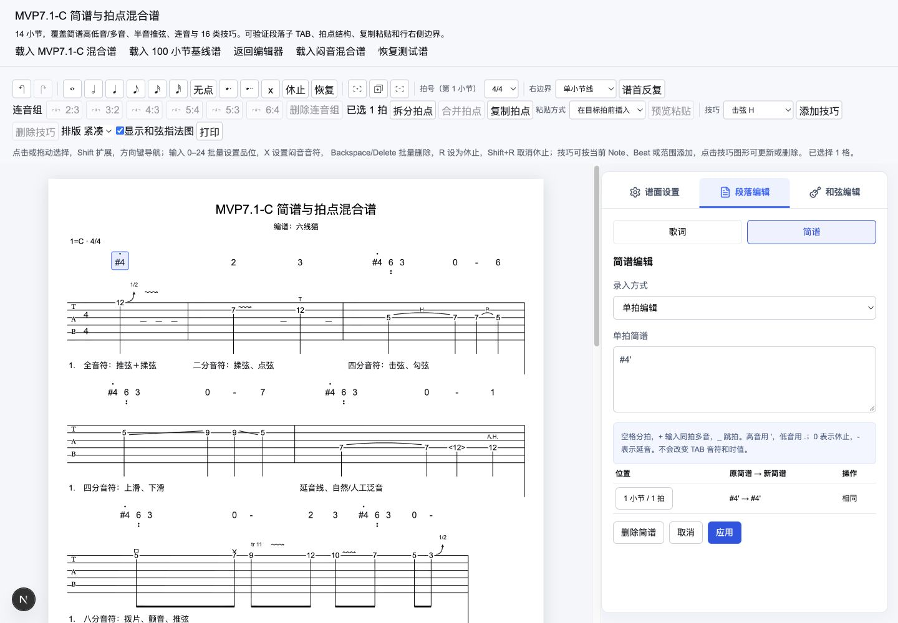
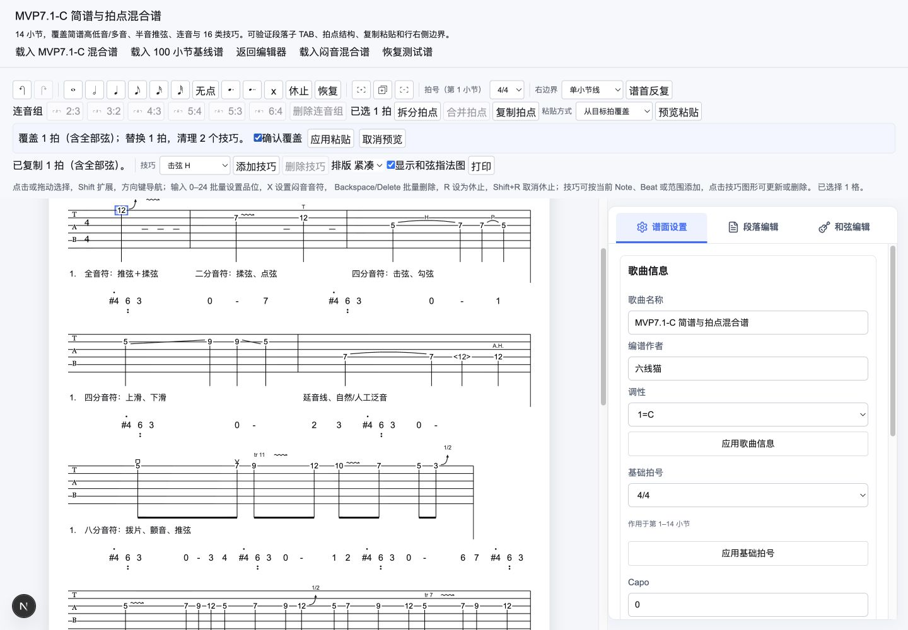
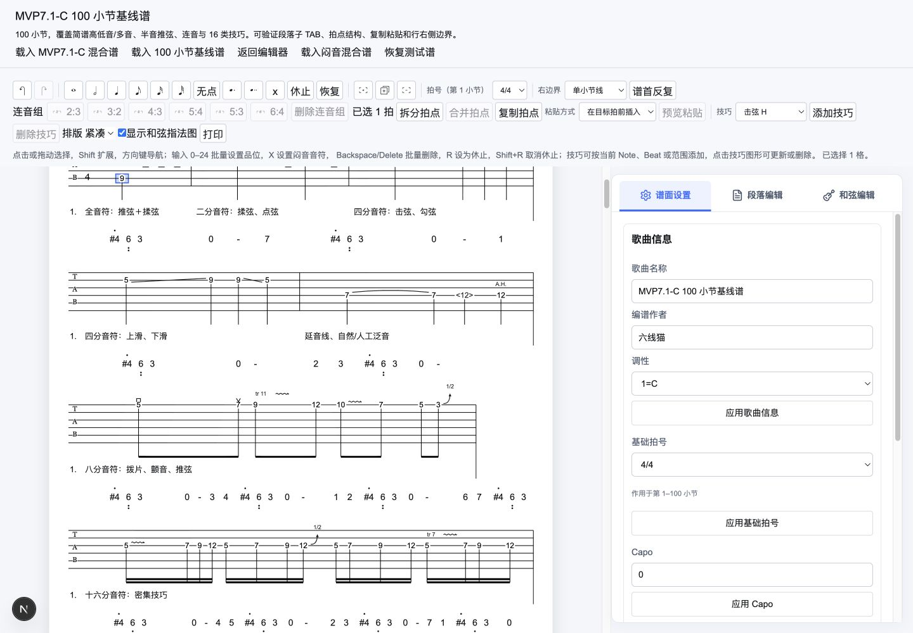

# MVP 7.1-C：拍点编辑、简谱与半音推弦实施验收

> 日期：2026-10-12。状态：已按用户复查后的授权实施。原 C/D 合并为同一个 7.1-C，当前 schema 7。下一阶段为 7.2。

## 1. 已交付范围

- 拍点等分与连续合并：持续数字音符逐弦建立/消费 Tie，保留首拍身份和文本，重映射外部连接与区间；拒绝 x、连音成员、不可表示时值及有歧义的内容丢失。
- 同小节 Beat 快照复制，支持插入与覆盖粘贴；完整重建嵌套 ID 和技巧引用。复制不进入历史，插入只消耗尾部未保护休止，覆盖需精确时间边界。预览记录文本、技巧与时长变化，破坏性操作须主动确认，确认绑定当前内容快照。
- 顶层“段落编辑”内用“歌词 / 简谱”子 TAB。切换保留目标 Beat 并高亮对应内容区域；空区域使用临时高亮。简谱默认连续输入，用半角/全角空格分拍，可跨已有小节与谱行，支持预览、跳过、覆盖确认、单拍修改与删除。
- 简谱受控语法：1–7、0、独立延音标记 `-`、升降前缀、最多三级高低音，同拍多音用 `+`；`_` 跳过。真实绘制高低音圆点并参与间距、行高和命中计算。
- 推弦支持半音 `1/2` 与全音 `Full`；已有全音数据保持含义。
- 每行最左侧竖线从第一弦延伸至 system 底部；1px 描边内缩半线宽，确保 SVG 左边缘完整显示。
- schema 4/5/6 显式迁移至 7。新字段参与运行时校验、复制、节奏保护、历史、宿主通知与外部替换。

实现依据为[合并方案](./20261012_拍点编辑乐句复用与半音推弦技术方案.md)第 8 节与[简谱方案](./20261012_简谱连续编辑技术方案.md)第 6 节。每次合法修改只有一次 revision、历史和宿主通知；失败/no-op 不生成修改。剪贴板版本独立于文档版本，复制不会清空正在编辑的文本草稿。

## 2. 工程验证

`pnpm type-check`、`pnpm lint`、`pnpm test`、`pnpm build` 均通过，`git diff --check` 无空白错误。全量测试为核心 479 项、网站 56 项，共 535 项。

新增测试覆盖语法、跨小节批次、覆盖与 no-op、保护休止、拆分/合并的内容和技巧边界、剪贴板隔离与引用合法性、过期确认、16 类技巧复用、迁移与半音模型、布局/命中/左边线、会话历史与宿主通知，以及 100 小节基线。

## 3. 桌面交互验收

在本地网站真实编辑器页面、1440 × 1000 桌面视口完成以下操作：

- 未选拍时段落编辑提示选拍；点击 TAB 或简谱进入对应 Beat，简谱点击聚焦输入框。
- 空格连续录入 16 项跨小节内容，包含跳过、高低音、多音、休止和延音；单拍修改后保留编辑模式。
- 未提交简谱切换歌词/编辑模式触发统一草稿保护；未确认覆盖时不能通过“应用后继续”，继续编辑保留草稿，放弃后正确切换。重复点击同一目标保留草稿。
- 歌词/简谱子 TAB 方向键切换后，选中项与键盘焦点一致。
- 拆分持续音生成 Tie，选中两拍后合并成功；拍点覆盖显示文本/技巧影响并要求勾选确认，随后可撤销与重做；插入粘贴保持合法容量。
- 100 小节混合谱可加载、浏览、输入品位、撤销与重做；原桌面检查记录了 598 个简谱图元。其间拍摄的截图仍显示旧版右侧竖线，不能作为本次左侧位置的视觉证据；其他交互流程与控制台检查记录仍有效。

上述截图采集于竖线位置修正前。修正后，布局测试检查每个 system 的左线横坐标、首弦起点和 system 底部终点。自动审批服务当前因模型配置错误未能执行浏览器复验，因此本次没有更新截图；该错误是审核服务故障，不是安全拒绝。

补充的“选中已有推弦，再切换幅度”浏览器步骤未完成：自动审批服务返回模型配置错误，操作没有执行。这不是安全拒绝；幅度模型、布局标签与工程检查已有验证，但该特定交互不计为浏览器已验收。

## 4. 百小节性能记录

环境为本机 arm64、Node 24.18。使用真实 100 小节混合谱，独立运行性能测试六轮，丢弃首轮预热，记录余下五轮中位数和最大值；布局交替紧凑/舒适密度，逻辑宽度 734。

| 操作                    |    中位数 |    最大值 |
| ----------------------- | --------: | --------: |
| 全谱核心布局            |  36.01 ms |  51.87 ms |
| 单拍简谱领域命令        |  36.78 ms |  49.58 ms |
| 覆盖粘贴规划 + 领域命令 | 148.45 ms | 150.30 ms |

这些数据是本机核心计算基线，不包含 React 提交、浏览器绘制、打印与 PDF。未把本机耗时作为产品阈值；7.2 需确定目标机器、多浏览器和输出测量方式。

## 5. 后续边界

本版不包含分页/PDF、跨小节自动扩展 Beat、任意拍点删除、跨小节 Beat 剪贴板、预推/回落、播放或作品文件管理。分页/PDF、真实中文 IME、目标多浏览器与系统打印继续归入 7.2，整个 MVP 7 尚未完成。
