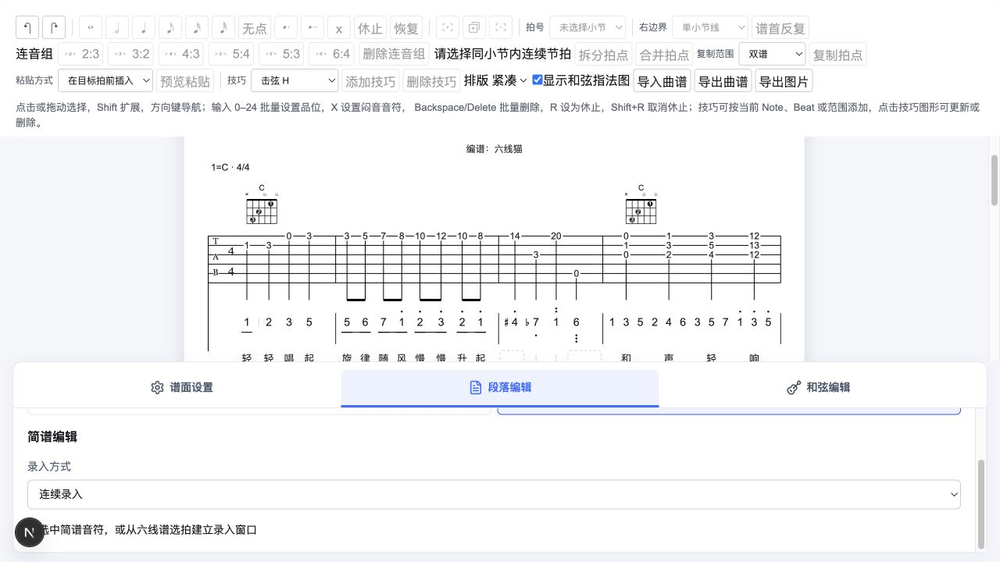
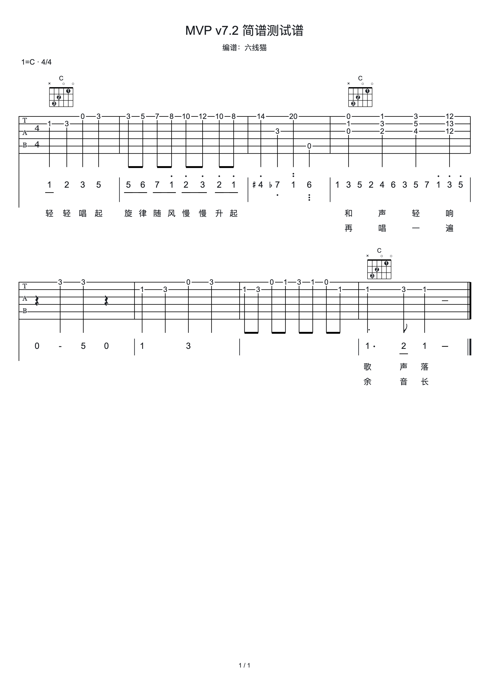

# 简谱时值与占位交互修正实施验收

日期：2026-10-14。依据：[技术方案](./20261014_简谱时值与占位交互修正技术方案.md)。四项修正已实施，不新增 schema 版本。

## 1. 实施结果

| 用户反馈          | 已落地行为                                                                                                              | 实现入口                                                                                                   |
| ----------------- | ----------------------------------------------------------------------------------------------------------------------- | ---------------------------------------------------------------------------------------------------------- |
| 升 4、降 7 撑高行 | Bravura 符号使用实际墨迹边界；在数字正文高度内等比缩放、垂直居中；符号完整显示且可命中，减时线按数字下缘计算            | `music-text-metric-reader.ts`、`numbered-notation-layout.ts`、`numbered-rhythm-layout.ts`                  |
| 简谱不需要 4/4    | 删除简谱行内拍号及对应专用留白；TAB 和公共信息继续显示拍号，小节线保留                                                  | `numbered-structure-layout.ts`、`system-layout.ts`                                                         |
| 改时值的行为      | 缩短保留目标音符，在后方产生真实空位；扩展保留目标音高和 ID，删除完整覆盖的后续事件，后面事件 tick 不移动；操作一次历史 | `numbered-commands.ts`、`command-effects.ts`、`NumberedEditor.tsx`                                         |
| 占位和 hover      | 空位从独立声部完整占用区间求补集；Tuplet gap 保留成员身份；同一最终 slot 提供占位、命中、hover、焦点和录入窗口          | `numbered-input-ranges.ts`、`numbered-input-layout.ts`、`music-text-hover.ts`、`MusicTextEditingHints.tsx` |

普通空白先按公共拍号单位分段，再按普通/附点时值分解；四分缩成八分释放的半拍只有一个八分槽。编辑器默认时值来自槽自身，不再默认四分。长音、休止和延时符内部没有假占位；完全空白的活动简谱行也有正文高度。

扩展切断后续长音、覆盖任何 Tuplet 或越过小节容量会拒绝。涉及 Tie/Slur/Fermata 丢失继续使用原子影响确认，不自动转接旧标记。当前音符时值预览与新文本录入的校验独立，改变时值不要求重新输入简谱内容。

## 2. 自动检查

| 检查              | 结果                           |
| ----------------- | ------------------------------ |
| `pnpm test`       | 615 项通过：核心 514，网站 101 |
| `pnpm type-check` | 两个包通过                     |
| `pnpm lint`       | 两个包通过                     |
| `pnpm build`      | 核心和 Next.js 生产构建通过    |

本轮新增 13 项回归。核心覆盖估算/真实墨迹下的 `#4/b7/n4` 行高与命中、简谱无拍号且保留小节线、缩短的精确半拍槽、长音占用、Tuplet gap 和拒绝部分覆盖；网站集成覆盖实际 store 缩短与撤销/重做、hover 与点击指向同一窗口、录入后槽消失、SSR 占位/hover 样式以及 Canvas 墨迹读数。原扩展重叠用例改为目标覆盖，并检查目标身份、TAB 不变及覆盖 effects。

根目录 Vitest 配置使用自动 JSX 转换，使编辑提示组件的 SSR 验证与 Next.js 的 JSX 编译方式一致。

## 3. 实际页面验收

使用当前本地开发页面和 MVP v7.2 简谱测试谱，通过页面控件完成：

1. 首个四分音符改为八分；预览提示释放可录入范围，第一拍后出现同一数字行的半拍占位。
2. 点击该占位，录入起点为“第 1 拍 + 1/2”，默认时值为八分；输入 `4` 并应用后占位消失。
3. 再选中原 `1` 改为四分，预览显示覆盖 1 个后续音符；应用后以 `1` 合并为四分，后面的 `2/3/5` 保持位置。
4. 取消编辑并撤销，恢复 `1/4` 两个八分；再次撤销录入，恢复后方半拍空位，TAB 选区为空。
5. 页面检查升降号完整显示，简谱行无 4/4，TAB 和顶部公共信息仍有拍号。
6. 通过“导出 A4 图片 → 生成此页图片 → 下载图片”下载真实 2480 × 3508 PNG，检查升降号和简谱基线一致，正式图片不含占位、hover 或选中提示。

浏览器自动化当前没有直接移动鼠标的公开接口，未将 hover 记为手工验证；其真实布局命中、目标比较及渲染样式已通过上述集成测试。

## 4. 资料与后续边界

验收资料保存在 `20261014_简谱交互修正验收资料/`，与上一轮独立节奏验收资料分开。用户已有本地开发服务保持运行。验收时工作区修改尚未提交 Git，后续提交以分支历史为准。

单事件时值扩展仍不拆分后续长音，也不覆盖完整 Tuplet；需要改变这些内容时使用现有范围/组编辑。这是本轮已确认的编辑边界。
