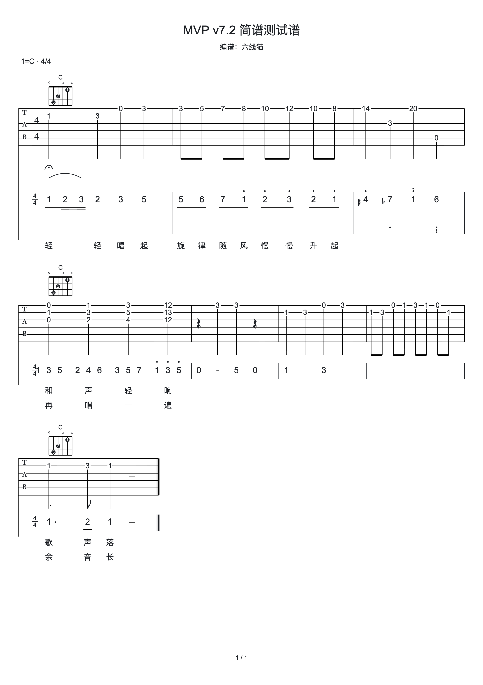

# 简谱独立节奏实施验收

日期：2026-10-14。方案经用户审查后授权实施；工作区基线 HEAD `c6be201`。主方案为 [简谱独立节奏与双谱对齐技术方案](./20261014_简谱独立节奏与双谱对齐技术方案.md)。

## 1. 交付结果

当前文档版本为 schema 8。简谱从 TAB Beat 中移出，以 `Measure.numberedVoice.events/tuplets` 和 `Track.numberedMarks` 保存。音符 item、事件、Tuplet、Tie/Slur/Fermata 各自有稳定 ID；公共小节、拍号、小节线、反复结构保持共用。

联合时间网格收集两谱起点、终点与长音单位锚点。约束求解保证最小字形距离、完整事件跨度和跨小节和弦间距，最终横坐标由两层共同使用。TAB 四分与简谱“前八后十六”使用起点 0/480/720/960，首数字中心与 TAB 起点相同；TAB 的宽度覆盖完整四分时长，不被简谱首子列截断。

| 模块           | 实施内容                                                                                                                                                           |
| -------------- | ------------------------------------------------------------------------------------------------------------------------------------------------------------------ |
| 核心数据与守卫 | schema 8、独立整数时值与稀疏声部、两层 ID 唯一校验、同音相邻 Tie、Slur 顺序/交叉/八层嵌套守卫、反复边界守卫                                                        |
| 命令与历史     | 独立事件内容/时值、范围模板、拆合、Tuplet 移除、记号增改删；候选预览与提交共用校验，一次 revision/历史；覆盖、失效记号和端点迁移确认                               |
| 布局           | 独立减时线/共享连梁、附点、延时横线、长休止零、八度点、升降还原、Tuplet 括号、跨行 Tie/Slur、Fermata、公共小节结构投影                                             |
| 编辑交互       | 段落编辑内简谱入口、前八后十六/前十六后八/三连音/自定义时值与比例、单 item 音高、起终点连接、拆合与范围复制；真实曲线和 item 命中，独立焦点，不建立或移动 TAB 选区 |
| 复用与结构     | 拍范围双谱/仅 TAB 复制、简谱时间范围复制、小节复制的独立 ID 映射；部分事件/部分 Tuplet 拒绝；公共容量变化校验两个谱层                                              |
| 文件与导出     | 冻结 schema 4/5/6/7，明确升级提示；宿主正常加载仍严格接受当前格式；SVG 与 Canvas 使用同一场景，全部简谱符号参与分页和 PNG 导出                                     |

关键算法、领域命令、转换和 UI 接入均补充中文注释。

## 2. 对接方式

新命令使用 `numbered.event.*`、`numbered.sequence.set`、`numbered.range.replace/paste`、`numbered.tuplet.remove` 和 `numbered.mark.*`。旧 `numberedNotation.*` 命令明确拒绝，并提示使用独立事件。`parseNumberedSequence` 保留文本语法；旧 TAB 序列预览 `planNumberedSequence` 已移除。

预览由 `editNumberedTrack(track, command, disposableIdFactory, true)` 构造候选；正式提交走 `applyScoreCommand`。预览不会增加 revision。间接删除或迁移记号时，用返回的影响 ID 和 `expectedRevision` 一次确认；失败不修改调用方文档，也不产生历史。

```ts
// TAB 四分拍保持原样，简谱独立录入三个先后事件。
applyScoreCommand(document, {
  type: "numbered.range.replace",
  trackId,
  measureId,
  startTick: 0,
  endTick: 960,
  items: ["1", "2", "3"].map((token) => ({ kind: "set", tokens: [token] })),
  rhythms: [
    { base: "eighth", dots: 0 },
    { base: "sixteenth", dots: 0 },
    { base: "sixteenth", dots: 0 },
  ],
  allowOverwrite: false,
});
```

一次音高修改可指定 `itemId`，保留该音符身份；整组文本变更按候选检查 Tie 等关系。TAB Beat 不提供简谱时值或标记引用。

剪贴板在 v2 下有两个严格入口：`BeatClipboard` 提供 `layers=tab|both`，`NumberedClipboard` 提供 `layers=numbered`、`tab=null`。后者完全由简谱时间窗口创建，不需要假 TAB Beat；两者共享 ID 工厂、声部复制和简谱校验。范围插入目前限一个小节，跨小节复用使用整小节范围复制。

## 3. 自动检查

| 检查               | 结果                                    |
| ------------------ | --------------------------------------- |
| `pnpm test`        | 核心 504 项、网站 98 项，共 602 项通过  |
| `pnpm type-check`  | 核心、网站通过                          |
| `pnpm lint`        | 核心、网站通过，无 warning              |
| `pnpm build`       | 核心构建及 Next.js webpack 生产构建通过 |
| `git diff --check` | 通过                                    |

新增核心测试覆盖：首音对齐与完整 TAB 跨度、TAB 拆分保留简谱、同音 Tie 影响确认/stale/no-op、旧 Tuplet 缺项升级为 gap、时值碰撞拒绝、两类剪贴板、跨小节关系删除确认、独立 Tuplet 移除、稳定 item 命中、Fermata/结构分页边界、旧格式伪装拒绝、Unicode 升降还原规范化、长音/长休止/附点、跨三行 Slur 穿过空小节、瞬时 effects。

网站补充：新格式标准谱例保真往返、旧文件预检显式升级与宿主严格加载、简谱历史不建立 TAB 选区、100 小节派生节点预算。文件原始结构、layout、scene 各自最多 200000 节点，不重复累计两份派生投影；文件仍受 10 MiB、1000 小节及两谱合计事件/技巧数量限制。上限是拒绝边界，不意味着任意极端分布都能达到数量上限。

旧测试已改用独立简谱模型；历史升级测试由专门 helper 构造真正的旧载荷，不将 schema 8 的新增字段伪装为旧版。

## 4. 页面验收与真实下载

在本地浏览器从默认示例进入“段落编辑 → 添加简谱行”，选“前八后十六”、输入 `1 2 3` 并明确覆盖。应用后显示起点“第1拍 / 第1拍 + 1/2 / 第1拍 + 3/4”，TAB 选区仍为空。

添加独立 Slur 和 Fermata；等分第一个持续音时，先显示“迁移 1 个记号”的原生确认，确认后生成两个十六分音及其 Tie，并显示时值与标记迁移 effects。页面撤销与重做可恢复完整动作。

下载原生 JSON 后读取并核对：schema 8、TAB 首拍仍为 quarter/dots=0、简谱前三事件 tick=0/480/720、时值 eighth/sixteenth/sixteenth，Slur/Fermata 保存到独立 numberedMarks。实际生成并下载 2480×3508 的白底 PNG，人工核对首音对齐、减时线、上下八度点、升降号、小节线、延长记号和 Slur，字形与页面一致。

- [实际下载验收谱](./20261014_简谱验收资料/前八后十六验收谱.lxm.json)
- [实际下载 PNG](./20261014_简谱验收资料/简谱导出验收.png)



## 5. 本版边界

- 单轨、单个简谱声部；同时多音由 event.items 表达，最多八音。多声部不是本次方案范围。
- 跨小节输入沿既有事件序列进行；范围模板和范围插入限一个小节。需要跨小节长音时分事件并使用 Tie，不能写一个越过小节容量的事件。
- Tuplet 支持既有六类比例；非整数实际 tick 明确拒绝。
- 延长时值发生重叠或越界时拒绝，不自动压缩后续简谱。缩短留下未录入空白，不补休止。
- 动态视觉节奏分组来自当前独立声部与拍号，不保存另一套 TAB 梁组。

工作区实现可继续审查和试用；本次未创建提交或 PR。
