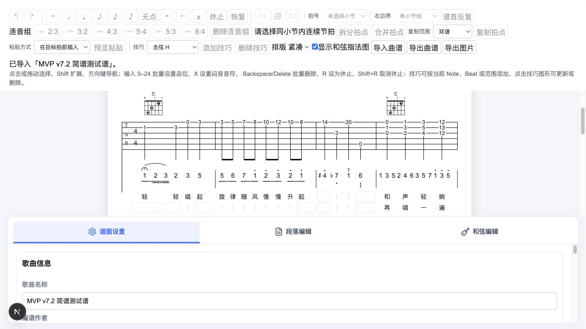
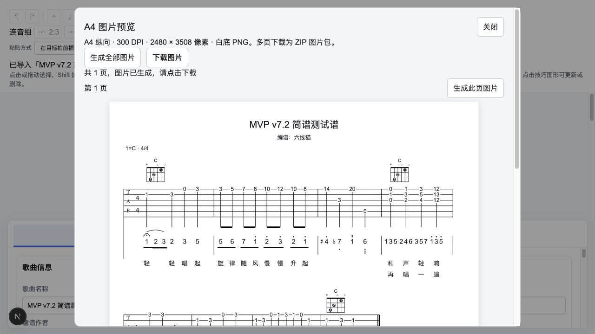

# 简谱紧凑排版与编辑展示分离实施验收

日期：2026-10-14。依据：[技术方案](./20261014_简谱紧凑排版与编辑展示分离技术方案.md)。第一版已实施，未更改曲谱 schema、音乐时间与时值编辑语义。

## 1. 本轮结果

| 项目     | 实施结果                                                                                                                      |
| -------- | ----------------------------------------------------------------------------------------------------------------------------- |
| 横向紧凑 | 简谱音乐预算独立于 TAB；数字组与相邻字形使用实际墨迹宽度，减少间隙；含简谱行拉伸上限为编辑 1.15、成品 1.08，纯 TAB 沿用原规则 |
| 编辑空位 | 普通槽争取 24 宽完整框，额外编辑内容预算限制为音乐内容的 25%；较宽槽优先，密集细分仍允许窄标记；点击时间窗口不缩水            |
| 上八度点 | 第一圆点到数字墨迹间隙为编辑 1.8、成品 1.3；多个点保留独立间隙，数字仍为 14 字号                                              |
| 连音线   | Tie/Slur 根据跨度采用较小且有上限的实际弧高；局部相关内容避让，范围外高八度点不抬高连线；嵌套层不再固定每层增加 14            |
| 成品输出 | 编辑使用 editing；预览/PNG/打印使用 presentation；预览与打印共用分页 SVG，PNG 消费同一成品 scene                              |

同 tick 的 TAB 与简谱仍共用时间列。几何模式不写入 JSON，不产生命令、revision 或撤销历史。成品不预留输入框和纯编辑空行，编辑空位/命中/焦点使用最终同一 slot。

## 2. 自动检查

| 命令               | 结果                           |
| ------------------ | ------------------------------ |
| `pnpm test`        | 624 项通过：核心 522，网站 102 |
| `pnpm type-check`  | 两个包通过                     |
| `pnpm lint`        | 两个包通过，无告警             |
| `pnpm build`       | 核心与 Next.js 生产构建通过    |
| `git diff --check` | 通过                           |

新增 9 项回归，覆盖两种 density 的成品/编辑宽度与前八后十六首音对齐、半拍完整框、纯编辑空行不进入成品、密集三十二分预算、局部 Slur 不受远处高音点影响、实际弧高 bounds、上八度点间隙、嵌套标记顺序稳定、纯 TAB 几何保持，以及字体就绪后成品准备确实使用 presentation。既有空位与 hover 测试显式传入 editing。

## 3. 实际浏览器验证

使用上一轮真实导出的 `前八后十六验收谱.lxm.json`，包含简谱细分节奏、Slur、Fermata、高低八度点、升降号、多音组与歌词。

- 页面检查编辑布局的数字组和上方记号紧凑可见，曲线与数字保持净空，TAB 与首音继续同 x。
- 使用“导出 A4 图片 → 生成此页图片 → 下载图片”下载真实 2480 × 3508 PNG，检查连线、八度点与多音组完整显示，图片不包含编辑提示。
- 对同一文档读取 A4 预览 SVG 与打印就绪层每页的图元内容，结果为 `samePageGeometry: true`，两者均为 1 页。打印 DOM 已就绪；本轮没有调用物理打印机或验收系统打印对话框。
- 在默认 MVP v7.2 谱的第 6 小节点击第 2 拍空位，打开“新增时间范围”，起点为第 2 拍、默认时值四分；完整框实际宽度约 24，准确命中独立简谱窗口。
- 验收标签页未出现浏览器 error 日志；临时标签页已关闭，用户原有开发服务保持运行。

[完整成品 PNG](./20261014_简谱紧凑排版验收资料/紧凑成品导出.png)

## 4. 使用与边界

网站自动选用两种用途，无需在录入时手动切换。现有“紧凑/舒适”选择仍保留。核心调用需要空位命中或激活空文本行时须明确传 `purpose: "editing"`，默认构建是成品用途。

歌词、品位、指法图和复杂技巧仍可成为最小列宽主导；因此成品不能只把简谱数字单独挤近而破坏双谱对齐。谱行允许适当右侧留白。打印最新快照未准备好时显示提示，避免输出旧内容。

验收时工作区尚未提交 Git，后续提交以分支历史为准。本轮参数作为可试用第一版，可依据实际谱面继续微调。
