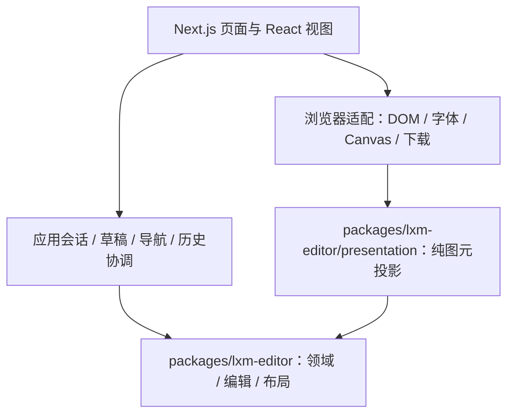

# 编辑器模块与职责边界重构技术方案

日期：2026-11-11。状态：本轮实施与验证完成。

后续源码位置已按业务子目录收拢，见[目录分组与模块内聚整理](./20261111_编辑器目录分组与模块内聚整理.md)；本文中的旧文件位置保留作为本轮职责迁移记录。

## 1. 目标与范围

本轮在已完成的性能与弹层生命周期优化之上，整理领域核心、浏览器适配和 React 展示的职责。保留既有未提交修改，不改变曲谱格式、编辑命令语义、草稿保护或界面设计。

方法采用 `antfu`、`vercel-react-best-practices` 和 Matt Pocock `codebase-design`：以职责和生命周期作为拆分依据，复杂实现通过小接口暴露。文件变短不是验收目标。

## 2. 分层与依赖方向

| 责任 | 放置位置 | 判断依据 |
| --- | --- | --- |
| 曲谱格式、节奏规则、引用校验、命令候选、布局和分页 | `packages/lxm-editor/src/core、editing、layout` | 不依赖宿主，可在 Node 环境测试 |
| 布局转显式音乐图元、绘制顺序和音乐身份关联 | `packages/lxm-editor/src/presentation` | 编辑 SVG、打印 SVG、Canvas 已共同消费，具有实际复用者 |
| 文档会话、撤销重做提交、草稿确认、导航与焦点策略 | `apps/website/stores` 和编辑器应用模块 | 即使是纯 TS，也属于当前产品的交互约定 |
| 字体加载、SVG 文字度量、Canvas 编码、Object URL、文件下载、localStorage | 网站浏览器适配模块 | 依赖运行环境，不反向进入核心包 |
| React hooks、JSX、Portal、弹窗动画、CSS Modules | 网站组件及邻近文件 | 属于展示和浏览器生命周期 |
| Next.js 路由、页面组合及资源配置 | `apps/website/app`、Next 配置 | 框架入口保持薄层 |

本轮使用现有编辑器包，不新增仅有一个消费者的 `shared`、`utils` 或 React UI package。纯 TS 不等于适合进入公共包；框架无关的应用交互逻辑可以留在网站内。

## 3. 本轮落地项

| 项目 | 当前位置 | 目标与最小接口 | 保留事项 |
| --- | --- | --- | --- |
| 音乐场景投影 | 网站 `score-scene.ts` | 核心包 `presentation/score-scene.ts`、`scene-types.ts`、`constants.ts`；`buildScoreScene(layout)` | SVG/Canvas 渲染器、选中颜色、DOM 字体探测仍在网站 |
| 通用布局平移 | `layout/technique-layout.ts` | `layout/layout-translation.ts`；`translateMeasure`、`translateBarline` | 技巧占高与谱行重排仍由技巧布局维护 |
| 选区协调 | `stores/editor-store.ts` | `stores/editor-selection.ts`；有效性修复、命令后定位 | store 统一原子提交 document/history/focus/feedback，不拆为独立写状态的 slices |
| 导出任务生命周期 | `ImageExportModal.tsx` | `use-image-export-task.ts` 统一准备、生成、取消、失效及 URL 释放 | Modal 保留关闭动画、焦点恢复和 DOM refs；复用原导出控制器 |
| 样式归属 | 21 个组件引用的 `index.module.scss` | 宿主布局、谱面交互、侧栏浮窗、工具面板共享样式和组件私有样式各归其主 | 维护响应式、打印、Portal 与 Ant Design 局部覆盖语义 |

本轮不拆复杂指针交互、不合并两套小节复制算法、不把简谱草稿状态按视图分散。`NumberedEditor` 范围复制粘贴、`SelectionTaskPanel`、技巧命令候选模块列为下一阶段候选；先收紧共享依赖与资源生命周期，避免同一轮交叉修改所有大型组件。

## 4. 样式迁移规则

1. `index.module.scss` 保留 editor 外壳、工作区网格和宿主布局变量；组件私有样式直接被对应组件导入，不通过 index 再次聚合。
2. Header、StatusBar、Toolbar 样式归对应组件；已有 `EditorToolbar.module.scss` 合并旧基础规则，保留容器查询和触控尺寸。
3. 侧栏及浮窗框架进入 `MusicTextSidebar.module.scss`；表单共享样式使用明确命名的模块。浮窗紧凑模式与侧栏模式不能拥有两份草稿。
4. 跨模块布局关系优先使用已有 `data-*` 布局标记或显式传入的宿主 class；不能依赖不同 CSS Modules 中同名 class 产生相同哈希。
5. 响应式调整跟随规则所属模块移动：工作区保留宿主 `data-layout`、Toolbar 保留 container query、技巧网格保留 viewport 600/380px 断点，三种机制不能互相替换。
6. 合并重复声明前核对最终级联：selectionPanel、statusBar、sidebarFooter、paragraphTabs、sequencePreview 均存在多段规则。保留最终视觉结果。
7. 打印的全局 Portal 隔离留在 `app/globals.scss`，成品页面留在 `score-print.module.scss`；组件仅管理自身隐藏。
8. 不按 grep 未命中直接删除样式；先排除动态 class、组合选择器与测试夹具引用。中文注释解释跨模块选择器及生命周期约束。

## 5. 行为不变量

- 场景图元顺序、颜色、字体、坐标和稳定业务 ID 不因迁移改变。
- 核心包不能依赖 React、Next.js、Zustand、Ant Design、DOM 或网站路径。
- 命令、撤销、重做仍一次提交；空选区与删除后的回退语义保持现状。
- 导出任务失效后，旧 Promise 不能更新新快照；URL 与 AbortController 在切范围、字体变化、关闭和卸载时按原时序释放。
- 侧栏隐藏、浮窗打开和 responsive 切换不重建草稿；保留 IME、焦点恢复与确认流程。
- 上一轮弹窗 closing 保护、memo 边界和 ID 工厂优化完整保留。

## 6. 实施与验证

顺序：代码回溯补齐接口和迁移清单 → 纯 TS 迁移 → 导出任务提取与样式迁移 → 审核差异 → 验证 → 更新实施记录。

| 检查 | 验证目标 |
| --- | --- |
| 核心 Node 测试与包构建 | scene/布局迁移不引入浏览器依赖 |
| 网站 scene、导出、store/history/session 测试 | 图元一致性、输出失效、定位及历史语义 |
| `pnpm lint`、`pnpm type-check`、`pnpm test`、`pnpm build` | 全仓库集成；不添加工具链 |
| TAB 编辑浏览器回归 | 图元、输入、删除、撤销重做、文件导出 |
| 工作区响应式/打印与生产页浏览器检查 | 样式归属迁移不破坏布局、侧栏、打印就绪及 Portal 隔离 |

测试优先复用行为测试；仅为新的边界或已有缺口添加必要回归，不为每次文件搬迁重复编写镜像测试。构建生成的非目标文件修改应清理。

## 7. 回溯补充与实施记录

### 7.1 代码回溯补充

- 场景迁移：`score-scene.ts` 仅依赖核心布局与常量；将导入改成包内相对路径，禁止从包自身根 barrel 导入造成循环。包根具名导出 `buildScoreScene`、`textPrimitive`、`SCORE_TEXT_FONT` 及场景类型。迁移全部网站消费者和测试，不保留网站纯转发壳。独立 Node 场景测试验证绘制输出；浏览器 SVG/Canvas 执行器仍留网站。
- 包出口细节：`package.json` 当前仅公开 `.`，继续从 `@liuxianmao/lxm-editor` 导入；不凭目录名称增加未定义的 `/presentation` 子路径。场景类型具名公开 `SceneStyle`、`ScorePrimitive`、`ScoreScene`；通用平移只是包内部模块，不扩大根出口。
- 实际消费者包含编辑器、`ScoreMusicLayer`、`ScorePresentationPage`、`score-canvas-renderer`、`image-export-controller`、`score-file` 导入预检。纯图元语义测试归核心；React 选中蓝色、字体实际测量、Canvas 取消与释放仍由网站测试承担。
- 不迁包的证据：`numbered-preview` 输出中文提示并引用 UI 类型；`music-text-draft` 含侧栏导航与和弦草稿；`chord-preferences` 含 React/localStorage/跨标签冲突与产品配额；`editor-object-selection` 返回侧栏动作。保留应用归属比仅按文件是否为 TS 分类更准确。
- 平移：`system-content-layout.ts` 已从技巧模块引用两个平移函数，迁移后两个调用模块直接引用新模块。`translateSystems` 依赖技巧占高，保持原位置；原内部导出无外部消费者时无需兼容转发。
- 平移范围约束：现有 `translateMeasure` 仅平移 TAB 基础几何；正文调用方另行平移 numberedNotation、lyrics、chordSymbols、visualBounds。本轮保留该有限接口并中文注明，不能扩成“完整小节平移”后仍保留调用方补偿，否则会双重移动。
- 选区：提取 `reconcileNumberedSelection`、`reconcileSelection`、`getSelectionCandidateAfterCommand` 原签名与实现。undo/redo 调用处的空选区保护不移动、不改动；不向新模块注入 store/set/get。该产品焦点策略不进入公共包。
- 导出：task/token、prepared/ref、download URL、range/inspected 共同归任务 hook。关闭动画开始即取消任务，afterClose 只负责卸载/焦点；hook 卸载处理 URL 与字体监听清理。保留准备阶段失效与生成阶段失效原有不同关闭路径，避免抽取时悄悄修改 UI 时序。StrictMode 模拟卸载不能导致旧任务写入重挂载后的状态。
- 关闭时序补充：requestClose 取消任务并设置同步 closing 门闩；退出动画期间拒绝字体失效触发重建、重试和新生成。下载 URL 保留到卸载，父 snapshot 在 afterClose/onClose 之前保持，继续阻断背景输出。焦点恢复属于 Modal，不由任务 hook 触发。
- 样式：Header、StatusBar 的紧凑模式依赖祖先 `.editor[data-layout]`；跨模块后以显式宿主数据标记定位，不用 `:global(.editor)` 猜测哈希。工作区对子栏的直接子选择器同理。浮窗对 `sidebarBody/Actions/Section/Footer` 的覆盖与基础规则一并核对；组件样式移动不能造成 import 顺序决定结果。
- 样式回归：已有 `score-view.browser.tsx` 直接消费 shell 样式，需与生产代码同步迁移；浏览器用例依赖类名前缀时改用稳定语义定位，不放松行为断言。打印由 globals 的全局隔离、成品层分页和各组件隐藏共同组成，不一股脑搬入公共包。
- 验证基线发现：`score-view.browser.tsx` 的测试控件曾引用不存在的 `scoreViewControls`，在 grid 中成为额外网格项，原浏览器用例在 1600px 出现外溢。修复测试控件的独立定位，保留生产布局的无外溢断言；不能把夹具问题归为本轮产品回归。
- 选区调用顺序：`nextFocus` 优先于命令回退；简谱命令保持 TAB 选区；空选区保持 null；TAB 失效先回退原小节再回退全谱首格，简谱失效直接清空。store 仍一次提交文档、历史、焦点与反馈。
- URL 事件约定：切输出范围清下载；切预览页仅废弃不匹配的单页下载，ZIP 保留；字体变化清准备结果与下载；重新准备清页码和错误。回调身份变化不能触发重新准备，任务令牌与快照版本校验同时保留。
- 本轮关闭路径取舍：准备阶段发现快照过期仍保留原直接通知父级关闭的行为；生成和用户关闭走 Modal 动画入口。统一两条关闭路径属于后续交互变更，本轮只补足关闭门闩与迟到结果保护，不修改已有时序。
- SSR 边界：`document.fonts`、Object URL 和监听仅在 effect/事件中访问；Portal 继续从 DOM ref 取得 `ownerDocument.body`。body 下的 Portal 不继承编辑器祖先，不能误套侧栏紧凑规则。
- 打印归属：`@page` 由成品打印模块唯一维护；交互模块仅管理自身打印隐藏。场景迁移同时覆盖仓库级 `scripts/editor-quality-baseline.test.ts`，避免网站旧路径残留。

### 7.2 实施记录

已完成以下职责调整，保留此前尚未提交的 memo、字体度量复用、命令影响映射、ID 游标和弹窗 closing 保护。

| 实施项 | 结果 |
| --- | --- |
| 核心场景 | `presentation/score-scene.ts`、`scene-types.ts`、`constants.ts`，根具名导出；删除网站旧实现，迁完生产消费者、网站测试与仓库基线脚本 |
| 包内布局 | `layout/layout-translation.ts` 接管基础几何平移；技巧重排和正文补偿仍各归调用方，中文注释明确避免双移 |
| 网站选区 | `stores/editor-selection.ts` 接管三项纯规则；store 保留原子提交和全部调用顺序 |
| 导出任务 | `use-image-export-task.ts` 与 `image-export-task-types.ts` 管理准备、生成、取消、字体失效、URL；Modal 保留动画和焦点 |
| 样式 | shell 从 1268 行降至 116 行、生产消费者从 21 个降至 1 个；Header、StatusBar、Toolbar、侧栏浮窗、谱面交互及表单分别归属，新增 7 个样式模块并复用既有私有模块 |

回归新增了一个实际修复：图片 Modal 原焦点恢复检查会把隐藏但常驻的工具浮窗误当作新对话框，导致焦点停在 body。现只在可见对话框存在时让出焦点，真实产品浏览器用例已覆盖关闭后回到导出按钮。

生产打印回归进一步发现：进入打印媒体后，字体事件会触发重新准备，但 globals 的隔离选择器将临时度量 SVG 及其文字也设为 `display:none`，造成零尺寸与错误降级。两个浏览器测量入口现标注 `data-score-text-measure`，打印隔离只对这类离屏、透明且 finally 删除的节点保留布局。业务 Portal 仍隐藏；新增真实浏览器断言主动在打印媒体触发字体事件，验证成品重新就绪和测量节点无残留。

验证记录：

- 全仓 `pnpm test`：146 文件、1491 项通过（核心 930，网站 561）；场景函数与平移函数搬迁主体已核对一致，新增 Node 场景快照检查完整输出与输入不变。
- `pnpm lint`、`pnpm type-check`、`pnpm build` 通过；最终焦点与打印修复后再次检查 lint、类型、10 项成品/导出测试与构建，全部通过。
- `image-export-task.browser.mjs`：React StrictMode、取消成功迟到、字体取消失败迟到、关闭期间禁止新任务、URL 卸载回收、准备/生成失效及下载有效性检查通过。
- `image-export.browser.mjs`：真实 PNG 签名和 2480×3508 尺寸、下载、切范围回收 URL、关闭焦点、重开无旧链接、打印期间字体重准备、文档/历史不变通过。
- `tab-continuation.browser.mjs`：键盘横线、可见图元、属性入口、删除、撤销重做及原生文件导出通过。
- `score-view.browser.mjs`：375～1920px 各宿主断点、fit/actual、滚动锚点、侧栏和打印 Portal 隔离通过；`numbered-editor-popover.browser.mjs` 的草稿、IME、Portal、复杂节奏回归通过。
- 样式基线截图及 computed style：桌面、768px 窄宿主像素一致；歌词浮窗和草稿自身无像素差异，整幅仅头部按钮边缘 8 像素 RGB 差 1。临时证据目录 `/tmp/editor-style-visual`。Vite 打印对比走相同度量失败降级提示，仅证明降级与隔离一致，生产成品打印另验。
- 最终标准 `next start` 独立进程 + Chromium 生产冒烟通过：首页 200、SSR/hydration 无控制台错误、真实图片生成、关闭焦点、打印媒体字体重准备、成品 SVG 页面保留与编辑区隐藏。实际查看 `/tmp/editor-style-visual/production-print.png`，确认一页完整曲谱、歌词、和弦图和页码，未出现错误降级。临时测量节点已清理。
- 核心依赖方向检查通过，无网站、React、Next、Zustand 或包根自引；`git diff --check` 通过，构建自动改写的 `next-env.d.ts` 已还原。

本轮未实施项仍为第 3 节列出的复杂指针、范围复制粘贴和大型任务面板拆分；未新建 package，未提交或推送。
