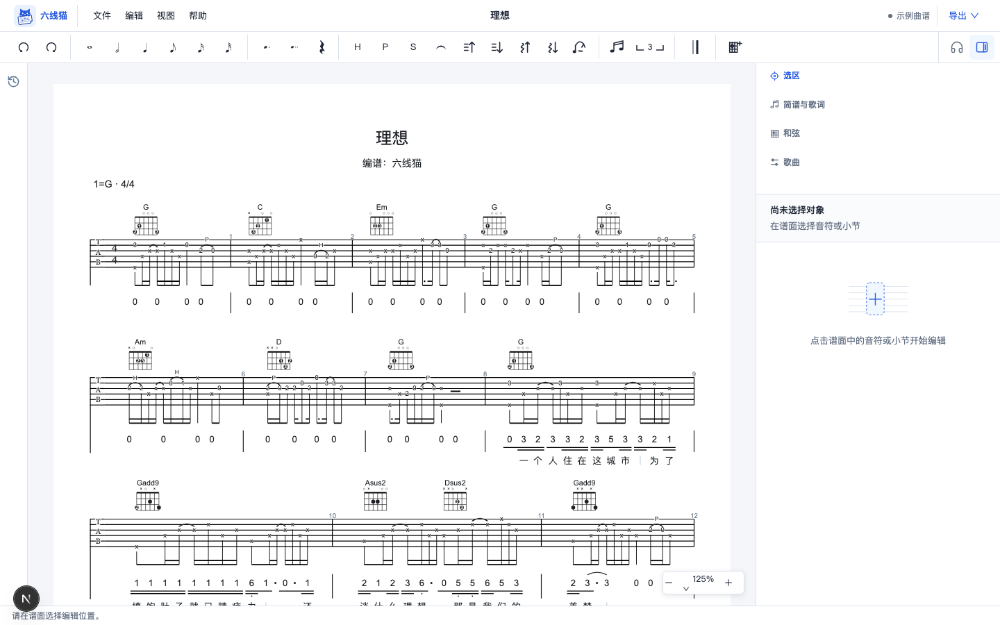

# 六线猫网站建设方案书

六线猫是我在湖南长沙开办的个人网站，主要用途是写吉他谱。练琴时，一段旋律既要记下音高和节奏，也要标出用哪根弦、按哪一品。六线猫把这些内容放在同一份谱里，还可以配上歌词和和弦，方便下次打开接着练。

本次申请备案一个网站，主域名为 `liuxianmao.com`。备案通过后，以 `https://www.liuxianmao.com` 为统一访问入口，直接输入主域名也会转到同一网站。网站使用简体中文。

## 网站栏目

**首页**展示一段两小节的吉他谱。访客可以切换谱层，对照同一拍的指法、简谱和歌词，然后新建一份空白谱，或打开电脑上的曲谱文件。首页下方还介绍了怎样把编辑器嵌入其他网页。

**曲谱编辑器**供用户逐小节写谱。用户可以在六线谱上标记弦和品位，调整音符时值，添加和弦指法图，写完后试听。曲谱文件在浏览器中打开和编辑，导出为 `.lxm` 文件后可以继续修改，也可以导出 PNG 图片或按 A4 纸打印。

**吉他进阶**收录节奏与拍点、和弦与进行、音阶与指板、弹奏技巧四组内容。每组用谱例说明一种练习方法，再配题目供使用者自测。例如，读完八分音符和十六分音符的说明，可以对着谱面数拍，再做相应练习。练习进度保存在使用者自己的浏览器中。

## 人员与经费

网站由本人维护。我负责更新编辑器，整理首页谱例和练习题，也负责服务器维护、域名和证书续期。日常开支主要是域名注册续费和云服务器租用费用。

本人投入方式及每周维护时间：________________　经费来源：________________

## 服务器与访问方式

网站选用阿里云北京地域的轻量应用服务器，配置为 2 核 CPU、1 GB 内存，操作系统为 Alibaba Cloud Linux 3。网站用 Next.js 开发，发布前在构建机上打包成 Docker 镜像，再将镜像部署到服务器。

备案期间在服务器本机检查页面。备案通过后，由 Nginx 接收域名的 HTTPS 请求，再转发给同一台服务器上的网站程序。程序的 3000 端口仅绑定本机回环地址。两个域名共用同一套页面，主域名跳转时保留原有页面路径。

## 内容管理与故障处理

首页谱例、乐理说明和练习题由本人维护。发布前，我会核对所用曲谱、文字和图片的来源及使用权。收到侵权反馈时，先核对具体页面和材料，必要时先撤下相关内容，再作修订。访客自行导入的谱只在其浏览器里编辑，导入操作不会将作品发布到网站上。

服务器管理和版本发布由本人操作。每次更新保留上一可用版本，上线前检查首页、编辑器和静态资源。若更新后出现白屏或编辑器打不开，我会查看容器日志，必要时恢复上一版本，再用样谱检查打开、编辑和导出是否正常。发现页面遭篡改时，先暂停公网访问，保留日志，核查管理账号和发布记录，从可信版本恢复后再开放访问。

## 负责人声明

本人承诺备案资料真实、准确，网站按本方案所列用途开办。如域名、网站内容或负责人信息发生变化，本人将按规定办理变更手续。如出现备案信息失实或违法违规内容，本人将配合接入服务商和主管部门核查、整改并接受依法处理。

网站负责人签名：________________

日期：________年____月____日
