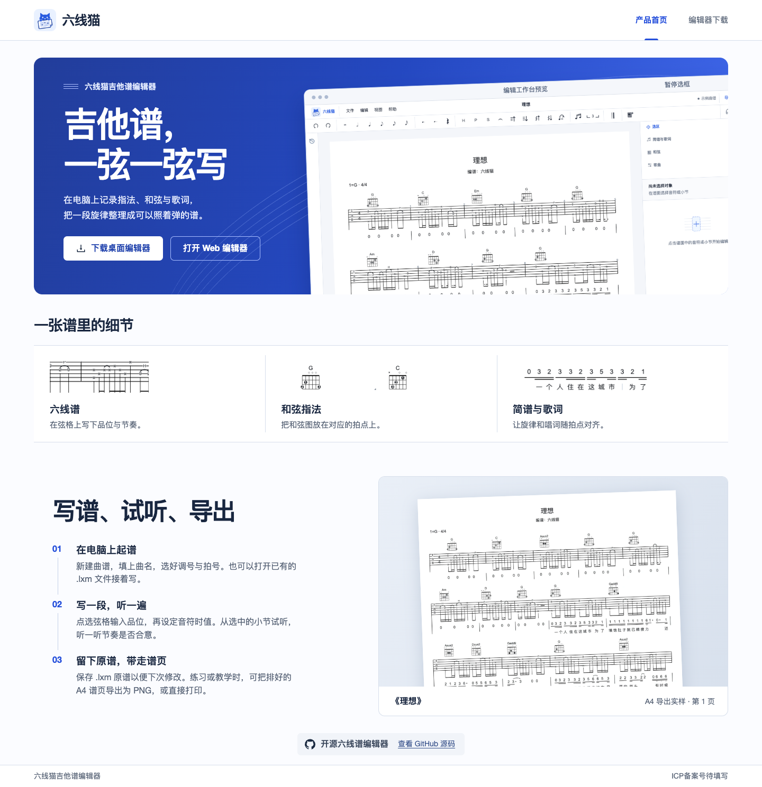
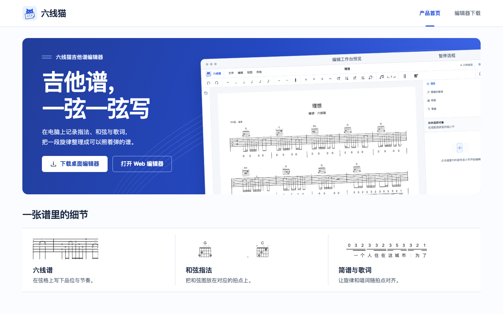
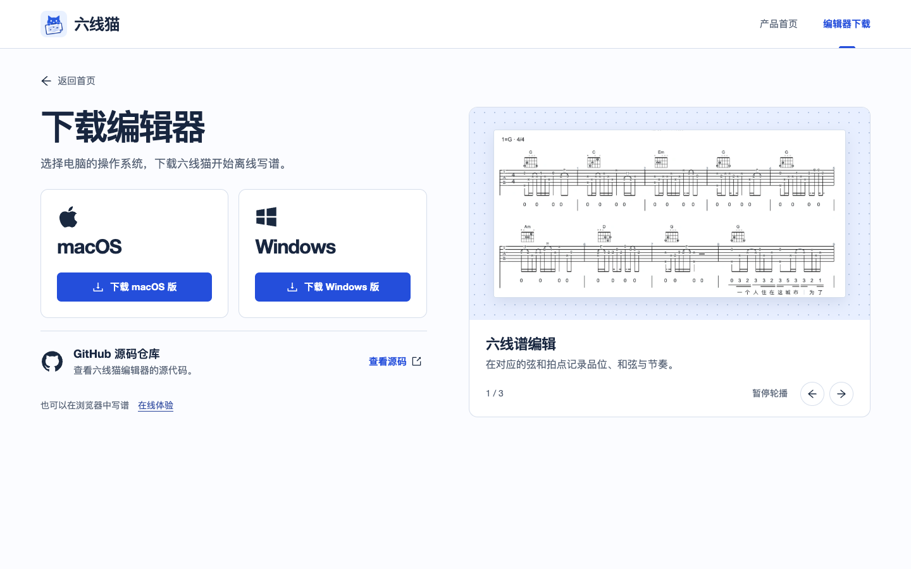

# REQ-015 · Web 产品首页与编辑器下载页

**首页评审稿 4，下载页评审稿 3。** 在现有验收服务刷新首页可重看开场动效，滚动至备案页脚上方可查看开源信息条。 [首页](http://127.0.0.1:4175/) · [编辑器下载页](http://127.0.0.1:4175/download.html)

| 首页完整长图 · 1440 × 1489 | 首页首屏 · 1440 × 900 | 下载页 · 1440 × 900 |
| --- | --- | --- |
|  |  |  |

## 本轮首页更新

1. 首屏 slogan 改为 **「吉他谱，一弦一弦写」**。它直接说明写的是吉他谱，也保留六线谱逐弦记录的产品记忆点。首页大标题「写谱、试听、导出」和 slogan 均去掉句号。
2. 原「从四小节练习，到一张成谱」改为以使用者任务为中心的 **「写谱、试听、导出」**。三步内容继续说明起谱、输入与试听、保存和 A4 输出。
3. 首屏新增清晰的双入口。「下载桌面编辑器」为主按钮，「打开 Web 编辑器」为次按钮。后者在原型中打开本地评审说明，拟接入仓库已有 `/editor` 路由，正式发布安排、地址和开放时间待确认。它没有打开真实路由，也没有宣称线上已发布。
4. 页底改为一行「开源六线谱编辑器　查看 GitHub 源码」。20px 图标、16px 标题与 14px 文字按钮并排居中，去掉副文案，并将上方间距收为 32px。原区块约 131px 高，新条在 1440px 视口实测约 316 × 42px。源码入口继续打开本地仓库说明。
5. 移除「《理想》谱面节选」辅助标签，保留实际谱例与相关截图。谱例公开展示授权继续作为上线前待确认项。
6. 工作台从下方 72px 处淡入，1320ms 后停在原位置。首屏文案与按钮自首帧可用。入场后段的第 1040ms 开始提示第一小节，选框每 4 秒重复一次，描边及淡出共 1.4 秒，再留白 2.6 秒。预览标题栏提供「暂停选框／继续选框」。首屏可见面积低于 20% 或标签页进入后台时冻结进度，返回时尊重手动暂停。系统开启减少动态效果时呈现静态谱面，禁用 JavaScript 时只保留单次工作台入场。备案页脚高 42px。

## 下载页评审稿 3

下载页反馈已纳入，左侧集中放置下载操作，右侧改为三张真实产品画面的轮播。macOS、Windows 和 GitHub 入口保持清晰可扫读。

- **六线谱编辑**使用《理想》编辑器谱面，展示品位、节奏、歌词和和弦图。
- **和弦指法**使用已有验证素材中的指法面板，展示 C 和弦的按弦关系。
- **A4 谱页导出**使用已有《理想》实际导出页，说明可用于练习或打印。

轮播每 7 秒舒展切换一次。鼠标悬停或键盘焦点进入轮播后暂停计时，鼠标离开或焦点离开重新计时。提供上一张、下一张、当前页数和暂停／继续按钮。切换过渡为 500ms。用户点击上一张或下一张时会回到对应画面并更新状态播报。系统减少动态效果时隐藏自动播放按钮，不做自动切换，手动切换保持可用。禁用 JavaScript 时保留第一张产品画面、文字说明和全部下载操作。

下载操作区下方增加低调文本链接「在线体验」。它与首页「打开 Web 编辑器」共用相同的原生评审说明，说明拟接入 `/editor`、正式开放时间与正式地址待确认。下载页原有三项资源的评审反馈仍保留，正式地址未确认前不写成真实下载或仓库外链。

## 需求依据与发布边界

通过本机默认认证的 `lark-cli sheets +csv-get` 读取「六线猫 bugfix」子表 `D9eELE` 第 17 行。A 列为 REQ-015，B 列为 v1.0，D 列为「待确认口径/原型」，E 列要求交互稿，F 列要求确认下载页、两端安装包、GitHub 仓库和进阶功能清单，G 列要求两端可下载、源码正确、进阶功能无公开入口且直接访问不对外开放。J 列「备注」为空。 [飞书原行](https://pcnhehlhivqu.feishu.cn/wiki/UEivw1G7Liuaqnk20d1cqCoxnHb?sheet=D9eELE&range=A17%3AG17)

桌面编辑器介绍依据已完成的 REQ-006、REQ-007「本地离线写谱」。源码内容依据已完成的 REQ-003。Web 编辑器入口来自仓库当前已有 `apps/website/app/editor/page.tsx`，本轮只在评审原型中说明拟接入，不修改产品路由。REQ-016 本地谱库不在本专题范围。 [工作台与谱面](../../design-baseline/editor.md) · [曲谱文件与试听](../../design-baseline/score-files.md) · [REQ-092 Windows 桌面版](../REQ-092-Windows桌面版/README.md) · [REQ-093 macOS 桌面版](../REQ-093-macOS桌面版/README.md)

本专题公开设计只包含首页和编辑器下载页。没有进阶功能入口。`/guitar-advanced` 及其模块、理论、练习、进度、考试、作答和结果深链继续列为上线前关闭清单。正式发布前应逐项用匿名访客直达、刷新和历史深链核对 404 行为。下载页与首页的真实安装包 URL、GitHub URL、Web 编辑器正式开放安排、备案号、谱例公开授权和支持的平台条件均待确认。

## 交互约定

| 位置与操作 | 本地原型反馈 | 正式发布预期 |
| --- | --- | --- |
| 首页「下载桌面编辑器」、顶栏「编辑器下载」、下载页「返回首页」 | 页面往返，浏览器历史可继续返回 | 首页与下载页均可独立访问、刷新和往返 |
| 首页「打开 Web 编辑器」或下载页「在线体验」 | 打开「打开 Web 编辑器」评审说明，关闭后焦点回到原按钮 | 接入确认的 Web 编辑器地址或发布安排 |
| 首页「查看 GitHub 源码」或下载页「查看源码」 | 打开「GitHub 源码仓库」评审说明，关闭后焦点回到原按钮 | 新标签页打开已确认的公开仓库 |
| 下载 macOS／Windows | 打开相应安装包评审说明 | 向浏览器交付已确认的对应安装包，保留下载页 |
| 下载页轮播上一张／下一张 | 切换画面、更新 `1 / 3` 和屏幕阅读器状态 | 保持手动切换和当前页反馈 |
| 下载页暂停／继续轮播 | 停止或恢复 7 秒自动切换；悬停和聚焦自动暂停 | 保持舒展自动切换，并尊重用户主动暂停 |

所有按钮和链接有键盘焦点。原生 `dialog` 在 Chrome 中用 Enter 激活，关闭后焦点回到原控件。下载页轮播第一张内容直接写在 HTML 中，无脚本时仍可读可用。首页动效和轮播切换均不依赖外网资源。

## 素材与技能

首页使用项目现有品牌图、真实《理想》编辑器截图、已有 A4 导出页和谱例局部。下载页轮播素材来自既有工作台、和弦指法和成品验证材料，新增资源均随原型保存在 `prototype/assets/`。 [品牌图](../../../../apps/website/public/assets/brand/liuxianmao-256.png) · [原编辑器截图](../../../../apps/website/assets/marketing/editor-preview.png) · [A4 来源](../REQ-100-自定义水印/prototype/score-pages.js) · [轮播和弦来源](../../../../docs/archive/mvp/design/04_实施验收/验收截图/20261016_AntDesign表单/和弦_1440.jpg)

本轮沿用 `ui-ux-pro-max` 的 reduced-motion 与焦点可见性建议，以及 `frontend-design` 的内容优先和克制动效原则。

## 客观验证记录

在既有 4175 服务上，用 macOS Google Chrome 158.0.8127.37、1440 × 900 视口验证首页稿 4。下表下载页结果沿用稿 3 的验证记录。

| 验证项 | 结果 |
| --- | --- |
| 首页布局与入口 | 全页 1440 × 1489，无横向溢出。开源条实测 316.125 × 42px，备案页脚高 42px。正常、减少动态效果和禁脚本三组均用 Enter 打开源码说明，Esc 关闭后焦点回到「查看 GitHub 源码」 |
| 首页动效 | 浏览器采样工作台顶边由 212.22px 升至 140.22px，起点、中段与终点均避开首屏按钮。实际停留至第 3 轮仍看到描边；手动暂停／继续、滚出自动暂停、滚回恢复、手动暂停后往返保留状态均通过。减少动态效果下活动动画数为 0，禁脚本时选框循环数为 0。两张首页截图均在工作台归位、第三轮描边淡出后的空档生成 |
| 下载页三画面 | 首张六线谱编辑、第二张和弦指法、第三张 A4 谱页均实际加载。普通模式自动切换、悬停暂停、焦点暂停、显式暂停／继续、上一张／下一张和循环回到首张均通过。切换过渡为 500ms |
| 减少动态效果与无脚本 | 减少动态效果隐藏自动播放按钮、不自动切换、手动切换通过。禁用 JavaScript 时第一张、下载卡、GitHub 和在线体验链接可见可操作 |
| 入口与导航 | 首页下载、Web、GitHub 入口；下载页两个安装包、GitHub、在线体验入口均用键盘打开对应说明，关闭后焦点恢复。首页与下载页往返、返回首页和刷新通过 |
| 资源与布局 | 首页 9 个、下载页 13 个图片元素均成功解码。两页横向滚动宽度均为 1440px。三种模式无控制台错误、未捕获异常、HTTP 失败或外网请求 |
| 下载页基线保留 | 下载页新增轮播后仍保留原下载卡、GitHub 行和返回导航。上一版下载页截图已在本轮替换为 1440 × 900 轮播版本 |
| 进阶边界 | 当前服务访问 `/guitar-advanced` 返回 404。两页可见链接不指向进阶路径。正式站仍需按完整清单逐项匿名访问确认 |

### 待确认项

1. macOS、Windows 安装包正式地址、实际架构与平台条件。
2. GitHub 公开仓库正式 URL及匿名访客可访问性。
3. Web 编辑器 `/editor` 的公开发布时间、正式入口地址和本期是否与下载页并列开放。
4. 首页备案号正式文字、展示要求和是否需要链接。
5. 《理想》谱例与 A4 页面的公开展示授权。
6. 进阶功能完整关闭清单及线上 404 验收路径。

## Next.js 实现与本地验收

- 实际页面为 `/` 与 `/download`。两页共用导航，复用品牌图、评审素材与原网站的编辑器。首页页末保留原谱层示例、开发者说明与 Web 编辑器开放时的新建／导入快捷入口。1440px 下首屏和开源条位置与原型一致，折叠说明使全页增加约 34px。实测开源条为 316.125 × 42px，页脚为 42px。 [首页](../../../../apps/website/app/page.tsx) · [下载页](../../../../apps/website/app/download/page.tsx)
- 公开源码入口已接入项目远端。部署文档与 Git 远端的仓库名一致，GitHub 匿名 API 返回 `private: false`、`visibility: public`。匿名 Releases 列表为空，两端正式安装包继续显示待发布说明。 [GitHub 仓库](https://github.com/li-jingxuan/liuxianmao) · [GitHub 匿名 API](https://api.github.com/repos/li-jingxuan/liuxianmao)
- 本地开发默认接入 `/editor` 和《理想》评审图。生产默认暂缓开放 Web 编辑器，首页与下载页显示开放说明，直接访问 `/editor` 返回 HTTP 404。阿里云既有部署说明将 `/editor` 列为验收入口，本次 REQ-015 将正式开放安排列为待确认，因此使用显式运行配置承接这一差异。 [发布配置](../../../../apps/website/lib/website-release.ts) · [阿里云部署说明](../../../../deploy/aliyun/README.md)
- 在正式站未确认《理想》公开展示授权前，默认使用仓库自有样谱《风吹过山谷》。首页预览、谱例局部和下载轮播首张来自实际编辑器，A4 图来自实际 PNG 导出。原评审图位于 `public` 之外，授权开关关闭时直达返回 404。生产编辑器也以《风吹过山谷》初始化，保留新建、导入、试听和导出。 [样谱源文件](../../../../packages/lxm-editor/example/default-score.lxm.json) · [素材路由](../../../../apps/website/app/previews/ideal/[asset]/route.ts)
- 本地开发默认在产品首页顶部导航显示「吉他进阶」。设置 `LXM_WEBSITE_INTERNAL_PREVIEW=0` 可同时关闭首页入口和进阶页面。技巧验收页在本地需显式设置 `LXM_WEBSITE_INTERNAL_PREVIEW=1` 才会开放。生产隐藏首页入口，并对 `/guitar-advanced`、其深链和 `/technique-test` 返回 HTTP 404。 [路由边界](../../../../apps/website/proxy.ts)

| 运行配置 | 确认后填入的值 |
| --- | --- |
| `LXM_WEBSITE_WEB_EDITOR` | `1` 开放生产站 Web 编辑器。首页与下载页共用此开关。 |
| `LXM_WEBSITE_MAC_DOWNLOAD_URL`、`LXM_WEBSITE_WINDOWS_DOWNLOAD_URL` | 各平台正式安装包的 HTTPS 地址。用服务器下载响应交付文件。 |
| `LXM_WEBSITE_ICP_NUMBER` | 确认的备案号文字。配置后在首页页脚链接备案网站。 |
| `LXM_WEBSITE_IDEAL_PREVIEW` | 公开展示获授权后设置 `1` 来启用评审谱面图片。本地开发可设 `0` 查看生产默认素材。 |

| 本地验证 | 实际结果 |
| --- | --- |
| Next.js 开发站 `http://127.0.0.1:3031` | Chrome 1440 × 900 验证首页、`/download`、返回导航、按键操作、安装包提示及关闭后焦点、图片解码、工作台 72px／1320ms 入场、4 秒选框节奏、手动暂停与滚出冻结、轮播 7 秒计时、悬停与聚焦暂停、500ms 切换、减少动态效果及无脚本首张。 |
| standalone 生产默认 `http://127.0.0.1:3176/app/liuxianmao` | 同一组浏览器验收通过。匿名直达并刷新进阶及内部验收页均返回 404，生产默认的 `/editor` 与未授权素材亦返回 404。 |
| standalone 发布配置 | 同一份子路径构建以测试值验证两端链接、备案链接、Web 入口、样谱与受控素材。生产进阶开关即使设置也维持 HTTP 404。测试值只用于独立本地进程。 |
| 构建与回归 | 网站 `type-check`、`lint`、Webpack 生产 `build` 通过。`lint` 有 4 条既有未使用参数警告。Vitest 99 个文件、920 项通过。REQ-011 浏览器回归验证无脚本正文及 `.lxm` 导出后重新导入。 [浏览器回归脚本](../../../../apps/website/tests/req015.next.browser.mjs) |
